# RocketMQ ACL 2.0 授权绕过、敏感信息泄露与兼容问题

本文用于组内同步 ACL 2.0 的安全问题与技术决策，重点回答五件事：

1. 具体是什么问题，影响哪些请求；
2. 为什么会出现；
3. 代码和调用流程如何证明；
4. 有哪些解决方案，各自有什么取舍；
5. 最终建议采用什么方案，以及还缺哪些验证。

本文统一按“问题代码尚未修复”的基线进行分析：问题描述和绕过流程表示存在缺陷的代码
行为；“修复方案”中的代码和流程表示建议实现的目标行为，不代表代码已经合入或部署。
验证章节列出修复完成后必须满足的验收条件。

本次修复和发布范围仅包含外部提交归并出的 E-01、E-02、E-03。S-01～S-20 和
R-01～R-08 保留在文档中用于后续迭代评审，不进入本次代码改动、测试矩阵和发布验收。

问题分为三类：

- **已确认漏洞/安全缺陷**：存在明确的绕过、越权或敏感信息泄露路径；
- **潜在风险/兼容问题**：代码证据明确，但利用条件、产品策略或兼容边界仍需确认；
- **实现边界/回归风险**：不是新的 ACL 漏洞，但错误处理会扩大改动范围或破坏原业务流程。

## 一、外部反馈并确认的漏洞

来源：
[Apache RocketMQ ACL Bypass 漏洞填报草稿](https://aliyuque.antfin.com/rongtong.jrt/cet83q/esatpghs0xz18utb)。
材料中的 5 封邮件按代码根因归并后是 3 个独立漏洞；第 5 封是 Broker
配置接口问题的强化 PoC，不单独算第 4 个漏洞。

### E-01：Proxy Cluster 只显式授权消息主链路，7 个 Remoting 扩展接口的 Header 未装入 Registry

- **结论**：已确认漏洞，High。
- **状态**：待修复。
- **影响范围**：Proxy Cluster 中 4 个可实际处理的消费者诊断/位点查询接口、1 个可构造
  转发路径的 POP 接口，以及 2 个已注册但业务分派不完整的 POP 控制接口。

#### 问题与影响

准确地说，这个问题不是 Proxy Cluster 完全没有安装 ACL Pipeline，也不是这些
RequestCode 的 Processor 没有注册到 RemotingServer。实际状态分为三层：

1. 7 个 RequestCode 的 Processor 都已注册到 Proxy RemotingServer；
2. 7 个 RequestHeader 源码也都已有 `@RocketMQAction` 和 `@RocketMQResource`；
3. 缺的是 Cluster Proxy 启动时执行 `RequestHeaderRegistry.initialize()`，导致这些
   Header 没有装入运行时 Registry。

Proxy Cluster 并不是所有 Remoting 请求都没有 ACL。ACL 2.0 初始实现已经在
`DefaultAuthorizationContextBuilder` 中为核心消息收发链路显式构造授权上下文，例如发送、
拉取、心跳和消费位点更新；这些分支不依赖 `RequestHeaderRegistry`，所以能够正常授权。

遗漏的是 Proxy 额外暴露的 Remoting 查询和 POP 扩展接口。这些 RequestCode 没有
显式分支，需要走默认的 Header 注解解析：

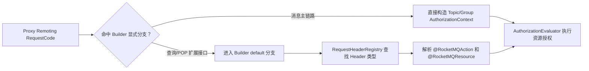

Proxy Cluster 启动时没有初始化 `RequestHeaderRegistry`，因此第二类接口的 Header 没有
注册。Builder 找不到 Header 类型，最终生成空授权上下文；Evaluator 对空列表直接
返回，导致请求未经资源授权继续执行。

#### 为什么会遗漏

当时只按 Proxy 的预期产品边界设计 ACL：认为 Remoting 入口只承载消息收发，商业产品也
不开放 Proxy Remoting Admin 接口。因此实现了消息收发的显式授权分支，却没有继续检查
Proxy Remoting Server 实际注册的其他 Processor，也没有把 `RequestHeaderRegistry`
初始化纳入 Proxy 生命周期。

按问题代码的实际注册集合与 Builder 分支做交叉检查：

- Proxy Remoting Server 共注册 24 个 RequestCode；
- 其中 15 个已被 Builder 的消息收发显式分支覆盖；
- 剩余 9 个会进入默认分支；
- 9 个里面有 7 个具备带授权注解的 RequestHeader，只要 Registry 正常初始化即可生成
  context，这 7 个属于本问题；
- 另外两个是 `LITE_PULL_MESSAGE` 和 `CHECK_CLIENT_CONFIG`。它们当时没有可由 Registry
  解析的对应 Header 映射，仅初始化 Registry 仍不能解决，属于 S-07 的显式映射遗漏。

本问题实际涉及的 7 个接口如下。表中的“实际处理状态”来自 Proxy 注册的 Activity 和
Activity 内部 switch，不把“已注册 RequestCode”直接等同于“业务一定执行成功”。

| RequestCode | 接口实际用途 | Header / 应授权资源 | Proxy 实际处理状态 | 本问题中的定性 |
| --- | --- | --- | --- | --- |
| `POP_MESSAGE`（200050） | POP 消费：从指定 Topic/Queue 为 ConsumerGroup 拉取消息并进入不可见期 | `PopMessageRequestHeader`；Topic + Group `SUB` | 注册到 `pullMessageActivity`，正常 POP Header 与 Pull 解码不完全匹配；特制补齐 Pull 字段的请求可保留 POP code 转发 Broker | 授权 context 缺失；存在条件性可执行路径，需进程 PoC |
| `ACK_MESSAGE`（200051） | 确认 POP 消息消费成功 | `AckMessageRequestHeader`；Topic + Group `SUB` | 注册到 `consumerManagerActivity`，但该 Activity 没有 ACK 分支，不会转发 Broker | 授权 context 缺失已确认；业务影响未证实 |
| `CHANGE_MESSAGE_INVISIBLETIME`（200053） | 修改已 POP 消息的不可见时间 | `ChangeInvisibleTimeRequestHeader`；Topic + Group `SUB` | 注册到 `consumerManagerActivity`，但该 Activity 没有对应分支，不会转发 Broker | 授权 context 缺失已确认；业务影响未证实 |
| `GET_CONSUMER_CONNECTION_LIST`（203） | 查询 ConsumerGroup 的在线客户端、连接地址、版本和订阅关系 | `GetConsumerConnectionListRequestHeader`；Group `GET` | `consumerManagerActivity` 本地读取并返回 | 可实际执行，直接绕过 Group 授权 |
| `GET_MAX_OFFSET`（30） | 查询 Topic 指定 Queue 的最大 Offset | `GetMaxOffsetRequestHeader`；Topic `GET` | `consumerManagerActivity` 转发 Broker | 可实际执行，直接绕过 Topic 授权 |
| `GET_MIN_OFFSET`（31） | 查询 Topic 指定 Queue 的最小保留 Offset | `GetMinOffsetRequestHeader`；Topic `GET` | `consumerManagerActivity` 转发 Broker | 可实际执行，直接绕过 Topic 授权 |
| `SEARCH_OFFSET_BY_TIMESTAMP`（29） | 按 Topic、Queue 和时间戳定位 Offset | `SearchOffsetRequestHeader`；Topic `GET` | `consumerManagerActivity` 转发 Broker | 可实际执行，直接绕过 Topic 授权 |

这些 Header 都已经声明 `@RocketMQAction` 和 `@RocketMQResource`；缺失的是 Proxy Cluster
启动时把它们注册进 `RequestHeaderRegistry` 的生命周期动作，而不是接口本身没有授权注解。

关键实际入口：

- Processor 注册：
  `proxy/src/main/java/org/apache/rocketmq/proxy/remoting/RemotingProtocolServer.java:211`
- POP 入站解码：
  `proxy/src/main/java/org/apache/rocketmq/proxy/remoting/activity/PullMessageActivity.java:41`
- 查询接口及 ACK/CHANGE 分派：
  `proxy/src/main/java/org/apache/rocketmq/proxy/remoting/activity/ConsumerManagerActivity.java:55`
- Registry 查询为空即返回空 context：
  `auth/src/main/java/org/apache/rocketmq/auth/authorization/builder/DefaultAuthorizationContextBuilder.java:473`

Local Proxy 会被内嵌 Broker 的 Registry 初始化间接兜底；Cluster Proxy 不创建
`BrokerController`，因此遗漏只在 Cluster 模式稳定暴露。

#### 绕过流程

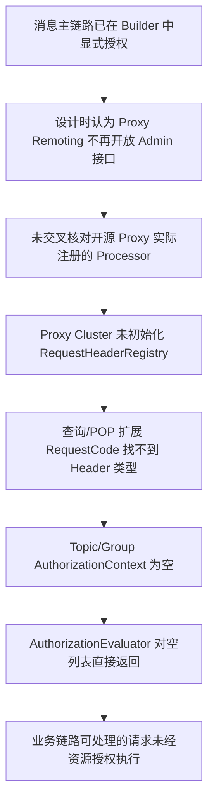

#### 修复方案

这个问题只有一个正确修复：保留消息主链路现有的显式授权映射，并在 Proxy Cluster 的
Remoting Processor 全部注册完成后统一执行 `RequestHeaderRegistry.initialize()`，把已经
带有授权注解的 RequestHeader 装入运行时 Registry。

初始化属于 Proxy Remoting 的启动生命周期，不能改成在 Builder 中逐个硬编码
RequestCode，也不能依赖商业网关或网络隔离替代代码修复。空授权上下文默认拒绝仅作为
纵深防御，不能替代 Registry 初始化。

关键位置：

- `proxy/src/main/java/org/apache/rocketmq/proxy/remoting/RemotingProtocolServer.java:246`
- `remoting/src/main/java/org/apache/rocketmq/remoting/protocol/RequestHeaderRegistry.java:39`
- `auth/src/main/java/org/apache/rocketmq/auth/authorization/builder/DefaultAuthorizationContextBuilder.java:473`

修复代码放在 Proxy Remoting 的 Processor 注册生命周期末尾，而不是任一业务 Processor：

```java
protected void registerRemotingServer(RemotingServer remotingServer) {
    // register SEND/PULL/POP/ACK/TopicRoute 等 Processor
    // ...

    RequestHeaderRegistry.getInstance().initialize();
}
```

初始化后，Builder 的注解兜底才能找到 Header 类型：

```java
Class<? extends CommandCustomHeader> clazz =
    requestHeaderRegistry.getRequestHeader(request.getCode());
if (clazz == null) {
    return result;
}
CommandCustomHeader header = request.decodeCommandCustomHeader(clazz);
```

#### 验证要求

- `POP_MESSAGE` 需要覆盖直接注解解析测试。
- 表中其余 6 个 RequestCode 需要各自独立的 context 测试。
- 4 个查询接口需要完成真实 Proxy Cluster 进程中的“低权限拒绝、正确权限允许”矩阵。
- `POP_MESSAGE` 需要使用同时满足 Pull/POP 解码字段的请求做进程级 PoC。
- `ACK_MESSAGE` 和 `CHANGE_MESSAGE_INVISIBLETIME` 没有完整业务分派，不能把“context
  缺失”直接表述为“消息确认或不可见时间修改已经成功”。
- S-06 的统一空上下文拒绝是防止未来再次漏初始化的纵深防线。

---

### E-02：5 个 Broker Admin 接口生成空授权上下文，普通用户可绕过管理权限

- **结论**：已确认漏洞，Critical/High。
- **状态**：待修复。
- **影响范围**：Broker 配置读取、配置修改及多组管理接口。

#### 问题与影响

以下 RequestCode 既没有被 Builder 显式处理，也不能通过 Header 注解生成有效的
授权上下文：

- `GET_BROKER_CONFIG`
- `UPDATE_BROKER_CONFIG`
- `UPDATE_AND_CREATE_SUBSCRIPTIONGROUP`
- `GET_BROKER_RUNTIME_INFO`
- `GET_ALL_CONSUMER_OFFSET`

外部材料的强化 PoC 证明：普通 `UserType.NORMAL` 用户使用自己的合法凭据通过认证后，
可以进入 `UPDATE_BROKER_CONFIG`，并修改 `autoCreateTopicEnable`。

#### 为什么会遗漏

这不是后续新增 RequestCode 时漏适配。上述 5 个接口在 ACL 2.0 引入前就已经由
`AdminBrokerProcessor` 处理。根因是 ACL 2.0 初版采用了两套授权上下文生成方式，但没有
覆盖“没有类型化 RequestHeader 的 Admin 请求”：

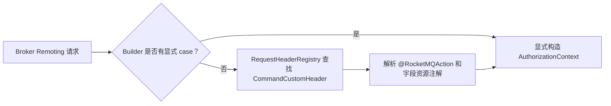

这 5 个接口的请求载体及应采用的授权语义如下：

| RequestCode | 请求载体 | 为什么注解兜底无效 | 建议授权语义 |
| --- | --- | --- | --- |
| `GET_BROKER_CONFIG` | `customHeader=null`，无请求 body | Registry 找不到 Header 类型 | Cluster `GET` |
| `UPDATE_BROKER_CONFIG` | `customHeader=null`，配置放在 body | body 不属于 Header 注解扫描范围 | Cluster `UPDATE` |
| `UPDATE_AND_CREATE_SUBSCRIPTIONGROUP` | `customHeader=null`，Group 配置放在 body | body 不属于 Header 注解扫描范围 | 从 body 提取 Group，要求 Group `CREATE` |
| `GET_BROKER_RUNTIME_INFO` | `customHeader=null`，无请求 body | Registry 找不到 Header 类型 | Cluster `GET` |
| `GET_ALL_CONSUMER_OFFSET` | `customHeader=null`，无请求 body | Registry 找不到 Header 类型 | Cluster `GET` |

#### 为什么定义这些 Resource 和 Action

Resource 只看请求入参能否定位到更细粒度的资源：有 Topic 或 Group 就使用对应资源；
没有 Topic/Group 入参才使用 Cluster。Action 按操作类型选择：读取用 `GET`，修改配置用
`UPDATE`，`UPDATE_AND_CREATE_*` 沿用现有 Topic upsert 约定使用 `CREATE`。

| RequestCode | 入参中的细粒度资源 | Resource | Action |
| --- | --- | --- | --- |
| `GET_BROKER_CONFIG` | 无 | Cluster | `GET` |
| `UPDATE_BROKER_CONFIG` | 无；body 是 Broker Properties | Cluster | `UPDATE` |
| `UPDATE_AND_CREATE_SUBSCRIPTIONGROUP` | `groupName` | Group | `CREATE` |
| `GET_BROKER_RUNTIME_INFO` | 无 | Cluster | `GET` |
| `GET_ALL_CONSUMER_OFFSET` | 无 | Cluster | `GET` |

`UPDATE_AND_CREATE_SUBSCRIPTIONGROUP` 的 `groupName` 可直接从请求 body 取得：

```java
SubscriptionGroupConfig config =
    RemotingSerializable.decode(
        request.getBody(), SubscriptionGroupConfig.class);
String groupName = config.getGroupName();
subscriptionGroupManager.updateSubscriptionGroupConfig(config);
```

关键业务位置：

- `broker/src/main/java/org/apache/rocketmq/broker/processor/AdminBrokerProcessor.java:1044`
- `broker/src/main/java/org/apache/rocketmq/broker/processor/AdminBrokerProcessor.java:1090`
- `broker/src/main/java/org/apache/rocketmq/broker/processor/AdminBrokerProcessor.java:1400`
- `broker/src/main/java/org/apache/rocketmq/broker/processor/AdminBrokerProcessor.java:1543`
- `broker/src/main/java/org/apache/rocketmq/broker/processor/AdminBrokerProcessor.java:1971`

ACL 2.0 初始实现中，Builder 对未显式匹配的 RequestCode 执行：

```java
default:
    result = buildContextByAnnotation(subject, command, sourceIp);
```

而注解路径找不到 Header 时直接返回空列表：

```java
Class<? extends CommandCustomHeader> clazz =
    requestHeaderRegistry.getRequestHeader(request.getCode());
if (clazz == null) {
    return result;
}
```

另外还有三个覆盖盲区：

1. `AdminBrokerProcessor` 通过 Broker 的 default processor 接收请求，再在自身的大
   `switch` 中分发；这些 RequestCode 不会全部显式出现在
   `BrokerController.registerProcessor()` 中。初版没有把该 switch 与 Builder 做完整交叉校验。
2. 初版 Builder 测试只验证了一组人工选择的消息面请求和少量注解请求，没有断言“所有
   Broker 可执行且需要授权的 RequestCode 都必须生成非空 context”。其中
   `UPDATE_BROKER_CONFIG`、`UPDATE_AND_CREATE_SUBSCRIPTIONGROUP` 在 ACL 1.0
   `Permission.ADMIN_CODE` 中已经属于 Admin 操作，也没有被用作 ACL 1.0 → 2.0
   语义对照基线。
3. `AdminBrokerProcessorTest` 直接调用业务 Processor，没有经过 Authentication/
   Authorization Pipeline；因此业务分支测试通过，并不能发现 Builder 返回空 context
   后被 Evaluator 放行。

因此这是“覆盖模型遗漏 + 测试不完整 + 空上下文 fail-open”共同造成的问题，不是单纯少写了
五个 case。

ACL 1.0 对照只能解释两个写接口为什么至少需要管理权限：
`UPDATE_BROKER_CONFIG` 和 `UPDATE_AND_CREATE_SUBSCRIPTIONGROUP` 曾属于
`Permission.ADMIN_CODE`。`GET_BROKER_CONFIG`、`GET_BROKER_RUNTIME_INFO`、
`GET_ALL_CONSUMER_OFFSET` 在仓库可追溯的 ACL 1.0 历史中并不属于
`ADMIN_CODE`；这三个读接口的 Cluster `GET` 是根据实际返回范围和 ACL 2.0
Resource 模型推导出来的，不能写成继承 ACL 1.0 Admin 语义。

#### 绕过流程

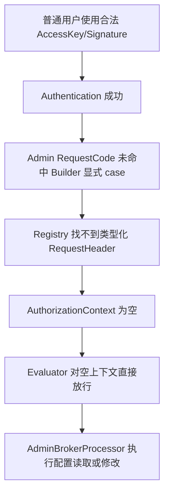

#### 修复方案

缺少授权上下文的接口必须在 AuthorizationContext Builder 中补齐 Resource 和 Action：
请求入参能够定位 Topic/Group 时使用细粒度资源，否则使用 Cluster。继续由标准
`AuthorizationEvaluator` 和 ACL Policy 完成授权，不在 `AdminBrokerProcessor` 中重复
实现 ACL 判断。

- `GET_BROKER_CONFIG`、`GET_BROKER_RUNTIME_INFO`、`GET_ALL_CONSUMER_OFFSET`
  映射为 Cluster `GET`；
- `UPDATE_BROKER_CONFIG` 映射为 Cluster `UPDATE`；
- `UPDATE_AND_CREATE_SUBSCRIPTIONGROUP` 从 body 提取唯一 `groupName`，映射为该
  Group 的 `CREATE`；
- `UPDATE_AND_CREATE_SUBSCRIPTIONGROUP_LIST` 遍历 body 中的所有 `groupName`，
  为每个 Group 分别生成 `CREATE` context。

关键位置：
`auth/src/main/java/org/apache/rocketmq/auth/authorization/builder/DefaultAuthorizationContextBuilder.java:408`

建议的核心映射逻辑如下：

```java
case RequestCode.UPDATE_AND_CREATE_SUBSCRIPTIONGROUP: {
    SubscriptionGroupConfig config =
        RemotingSerializable.decode(
            command.getBody(), SubscriptionGroupConfig.class);
    if (config == null || StringUtils.isBlank(config.getGroupName())) {
        throw new AuthorizationException(
            "subscription group is null.");
    }
    result.add(DefaultAuthorizationContext.of(
        subject,
        Resource.ofGroup(config.getGroupName()),
        Action.CREATE,
        sourceIp
    ));
    break;
}

case RequestCode.GET_BROKER_CONFIG:
case RequestCode.GET_ALL_CONSUMER_OFFSET:
case RequestCode.GET_BROKER_RUNTIME_INFO:
    result.add(DefaultAuthorizationContext.of(
        subject,
        Resource.ofCluster(authConfig.getClusterName()),
        Action.GET,
        sourceIp
    ));
    break;
```

选择 `CREATE` 而不是在 ACL Pipeline 中动态选择 `CREATE/UPDATE`，是因为同类
`UPDATE_AND_CREATE_TOPIC` 已把 upsert 定义为 Topic `CREATE`。如果产品确实需要区分
“创建 Group”和“更新已有 Group”，应拆分协议动作或新增明确的 upsert 语义，不应让
ACL Pipeline 查询 `SubscriptionGroupManager`，否则会把授权逻辑侵入业务状态。

对于其余四个接口，标准 `AuthorizationContext` 为：

```text
Subject = 已认证用户
Resource = Cluster:<brokerClusterName>
Action = GET 或 UPDATE
SourceIp = 服务端取得的请求来源地址
```

#### 验证要求

- 需要覆盖携带真实 body 的单组 Group `CREATE` context。
- 需要覆盖批量请求逐 Group 生成 `CREATE` context。
- 需要覆盖单组 body 缺失和批量列表为空时 fail-closed。
- ACL 1.0 的 `Permission.ADMIN_CODE` 只能作为两个写接口的历史依据，不能用于推导三个
  读接口的 Action。
- 严格 Evaluator 必须对未映射且未显式豁免的 RequestCode fail-closed，防止同类
  漏映射再次变成放行。
- 需要补充原始“普通用户修改 Broker 配置”PoC 的完整 Pipeline 回归。
- 需要完成真实 Broker 进程中的低权限拒绝和正确权限允许矩阵。
- S-02 的配置响应脱敏是后续纵深加固，不是本漏洞的直接修复。

---

### E-03：gRPC 客户端可伪造来源 IP，绕过 IP ACL

- **结论**：已确认漏洞，High。
- **状态**：待修复。
- **影响范围**：所有依赖来源 IP 限制的 Topic、Group ACL。

#### 问题与影响

客户端可以在 gRPC Metadata 中预先写入 `rpc-remote-address`。
`HeaderInterceptor` 使用 put-if-absent 写入真实 socket 地址；客户端值已经存在时，
服务端值不会覆盖它。

#### 出现原因

客户端 Metadata 和服务端连接属性共用了同一个键，但实现没有定义该字段的所有权。
`put-if-absent` 适用于普通业务 Metadata，却不适用于参与授权决策的来源地址：客户端值
一旦先写入，服务端可信值就失去了覆盖权。

#### 绕过流程

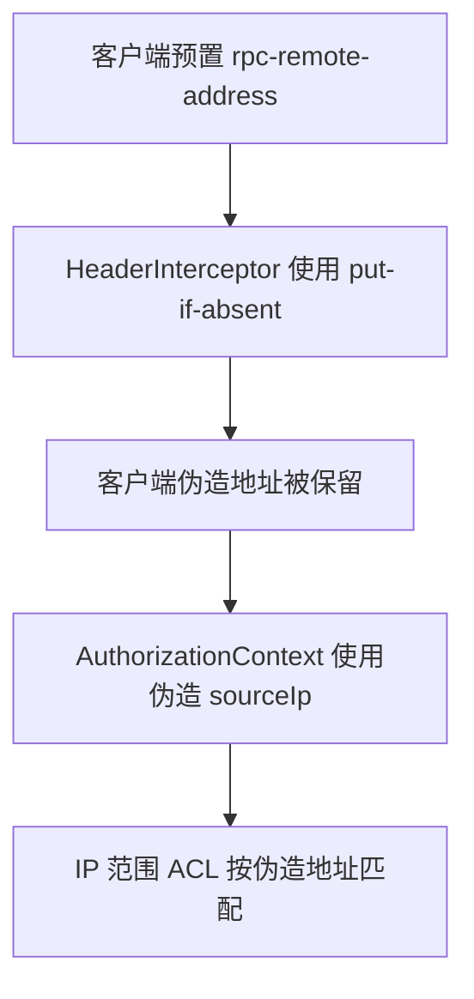

#### 可选方案

| 方案 | 做法 | 优点 | 缺点 |
| --- | --- | --- | --- |
| A. 服务端强制覆盖 Metadata | 删除客户端同名字段，再写入连接属性解析出的地址 | 对客户端兼容；服务端值具有唯一权威性 | 必须保证所有入口都经过同一 Interceptor |
| B. 客户端只要携带保留字段就拒绝请求 | 检测到 `rpc-remote-address` 立即报错 | 边界最严格，容易审计 | 可能破坏已有客户端或中间层；仍需服务端重新写入真实值 |

#### 最终建议

采用方案 A：`rpc-remote-address` 和 `rpc-local-address` 一律由服务端从连接属性生成并
覆盖，客户端值不得参与授权。来源地址应由服务端强制覆盖：

```java
String remoteAddress = getProxyProtocolAddress(call.getAttributes());
if (StringUtils.isBlank(remoteAddress)) {
    SocketAddress socketAddress =
        call.getAttributes().get(Grpc.TRANSPORT_ATTR_REMOTE_ADDR);
    remoteAddress = parseSocketAddress(socketAddress);
}
GrpcUtils.putHeader(headers, GrpcConstants.REMOTE_ADDRESS, remoteAddress);
```

`GrpcUtils.putHeader` 不应使用 put-if-absent，而应先删除客户端传入的同名 Metadata：

```java
public static <T> void putHeader(
    Metadata headers, Metadata.Key<T> key, T value) {
    if (headers == null) {
        return;
    }
    headers.discardAll(key);
    if (value != null) {
        headers.put(key, value);
    }
}
```

`REMOTE_ADDRESS` 和 `LOCAL_ADDRESS` 均以服务端连接属性为准。

关键位置：

- `proxy/src/main/java/org/apache/rocketmq/proxy/grpc/interceptor/HeaderInterceptor.java:47`
- `proxy/src/main/java/org/apache/rocketmq/proxy/common/utils/GrpcUtils.java:37`

#### 验证要求

- 需要测试正常请求使用真实 remote address。
- 需要测试客户端预置地址时由服务端覆盖。
- 需要完成真实 gRPC 进程配合 IP ACL 的负向测试。
- R-02 的 PROXY protocol 信任边界是另一条传输层风险，不属于本漏洞。

---

## 二、后续迭代：内部复核确认的安全问题

本节问题不纳入本次外部漏洞修复范围，后续单独评审、修改和验收。

### S-01：GET_USER/LIST_USER 未限制密码读取者，普通用户可获取其他账号密码

- **结论**：已确认漏洞，P0。
- **状态**：待修复。

#### 问题与影响

`GET_USER` 和 `LIST_USER` 只要求 Cluster `GET`，但响应阶段没有继续判断调用者是否有权读取
目标用户的密码。普通用户只要具有接口查询权限，就可能读取其他普通用户或 SUPER 用户密码。

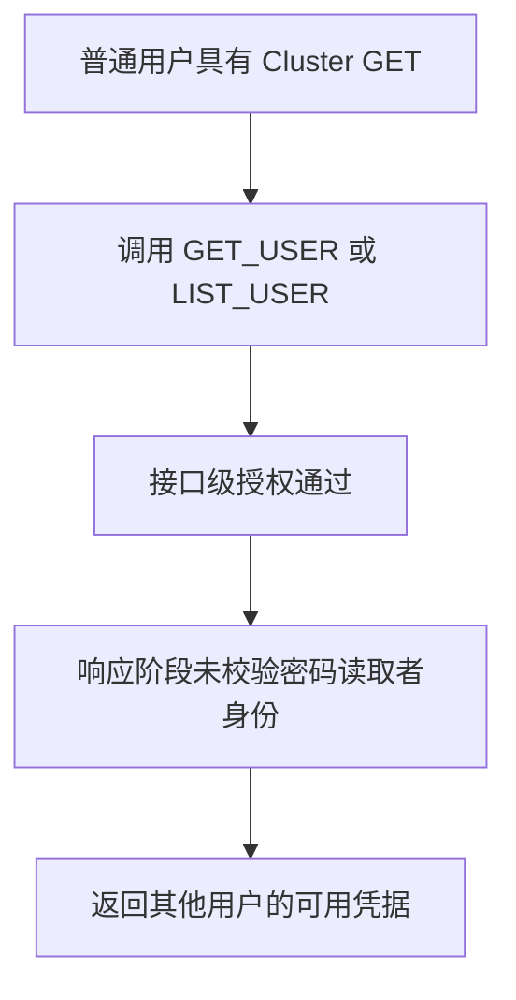

#### 出现原因

接口权限只控制“能否查询用户”，没有单独控制“谁能读取密码”。字段如何在 `User` 和
`UserInfo` 之间转换不是安全边界；密码是否可返回必须由已认证调用者身份决定。

#### 认证链对密码的依赖

这个问题不能通过“从所有 User 查询中删除密码”解决。Authentication Provider 必须取得
目标用户密码，才能校验客户端签名：

```java
return authenticationMetadataProvider
    .getUser(context.getUsername())
    .thenAccept(user -> doAuthenticate(context, user));

// doAuthenticate
String signature = AclSigner.calSignature(
    context.getContent(), user.getPassword());
```

Cluster Proxy 没有本地用户密码时，还会通过 Broker 查询目标用户：

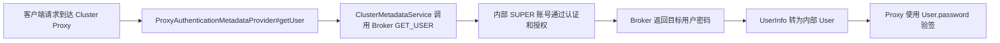

Proxy 发起该请求时使用 `innerClientAuthenticationCredentials`；Broker 初始化该内部账号时
将其设置为 SUPER。因此，如果 `GET_USER` 对所有调用者都删除密码，Cluster Proxy 得到的
`User.password` 为空，正常客户端签名也会验证失败。

#### 修复方案

只限制 Admin 查询接口的响应出口，不删除认证链中的密码：

- 持久化 `User` 和 `AuthenticationMetadataProvider#getUser` 必须保留密码。
- Proxy 把 Broker 返回的 `UserInfo` 转为内部 `User` 时必须保留密码，供验签使用。
- `LIST_USER`：任何调用者都不返回密码。
- `GET_USER` 查询自己：返回密码。
- 已认证 SUPER 调用 `GET_USER`：返回目标用户密码；Cluster Proxy 的内部 SUPER 账号依赖
  该能力。
- 普通用户查询其他用户：只返回用户名、类型、状态。
- 认证关闭、接口在认证白名单中或没有可信 AccessKey：不返回密码。

长期如果要完全取消 Admin API 返回密码，必须先为 Cluster Proxy 提供独立且仅服务端可用的
认证元数据通道，不能直接删除现有响应字段。

关键代码：

```java
// 密码是否出现在响应中，由已认证调用者身份决定。
UserInfo userInfo = UserConverter.convertUser(user);
if (canReadUserPassword(request, requestHeader.getUsername())) {
    userInfo.setPassword(user.getPassword());
}
```

回填判断使用实际经过认证的 AccessKey，而不是目标用户参数：

```java
String accessKey = getAccessKey(request);
if (StringUtils.isEmpty(accessKey)) {
    return false;
}
if (StringUtils.equals(accessKey, username)) {
    return true;
}
return this.brokerController.getAuthenticationMetadataManager()
    .isSuperUser(accessKey).join();
```

关键位置：

- `broker/src/main/java/org/apache/rocketmq/broker/processor/AdminBrokerProcessor.java:3188`
- `broker/src/main/java/org/apache/rocketmq/broker/processor/AdminBrokerProcessor.java:3369`
- `auth/src/main/java/org/apache/rocketmq/auth/authentication/chain/DefaultAuthenticationHandler.java:45`
- `auth/src/main/java/org/apache/rocketmq/auth/authentication/manager/AuthenticationMetadataManagerImpl.java:87`
- `proxy/src/main/java/org/apache/rocketmq/proxy/auth/ProxyAuthenticationMetadataProvider.java:61`
- `proxy/src/main/java/org/apache/rocketmq/proxy/service/metadata/ClusterMetadataService.java:236`

#### 验证要求

- `AdminBrokerProcessorTest` 需要覆盖本人、SUPER、其他普通用户、LIST 和不可信身份。
- `ClusterMetadataServiceTest` 需要确认 Broker 返回的密码能够转换并保留在 Proxy 内部
  `User` 中。
- 需要完成 Cluster Proxy 进程级验签回归，证明内部 SUPER 查询目标用户后可以正常验证
  客户端签名。
- Broker 无法从账号本身识别“内部 Proxy 账号”，因此不增加专用账号类型，而是使用现有
  SUPER 语义。
- 方案仍允许 SUPER 单查用户密码；密码本身仍以可读形式存储。

---

### S-02：GET_BROKER_CONFIG 泄露初始化密码和内部客户端凭据

- **结论**：已确认敏感信息泄露，P0。
- **状态**：待修复。

#### 问题与影响

通过 ACL 获得配置读取权限后，接口直接返回全部配置，其中包括：

- `initAuthenticationUser`
- `innerClientAuthenticationCredentials`

这是“授权通过后响应字段过度暴露”，与 E-02 的“接口没有生成有效授权上下文”是两个问题。

#### 出现原因

通用配置导出没有区分普通配置和秘密配置；ACL 只判断调用者能否读取 Broker 配置，不能
自动决定响应中的每个字段是否应该公开。

#### 可选方案与最终建议

| 方案 | 取舍 |
| --- | --- |
| 删除已知敏感字段 | 改动小，但新增秘密字段时可能再次遗漏 |
| 只输出明确允许公开的字段白名单 | 默认安全，长期维护性最好；初次梳理成本较高 |
| 返回完整配置但对值做掩码 | 便于看到字段存在，但仍可能暴露结构信息，且掩码容易不完整 |

**最终建议**：先删除两项已知秘密并在解析失败时 fail-closed；长期改成安全字段白名单
或专用响应 DTO，新配置字段默认不对外。

#### 实现要点

将配置字符串解析为 `Properties`，删除上述字段后再编码返回；解析失败直接返回
`SYSTEM_ERROR`，不允许回退到未脱敏原文。

关键位置：

- `broker/src/main/java/org/apache/rocketmq/broker/processor/AdminBrokerProcessor.java:1095`
- `container/src/main/java/org/apache/rocketmq/container/BrokerContainerProcessor.java:304`

Broker 和 Container 应使用相同的 fail-closed 脱敏方式。建议的 Broker 路径核心代码：

```java
String content = brokerController.getConfiguration().getAllConfigsFormatString();
Properties properties = MixAll.string2Properties(content);
if (properties == null) {
    response.setCode(ResponseCode.SYSTEM_ERROR);
    response.setRemark("Failed to sanitize broker config");
    return response;
}
properties.remove("initAuthenticationUser");
properties.remove("innerClientAuthenticationCredentials");
content = MixAll.properties2String(properties, true);
response.setBody(content.getBytes(MixAll.DEFAULT_CHARSET));
```

这里必须先成功解析并删除敏感字段才能设置响应 body；解析失败不会返回原始 `content`。

#### 验证要求

- 需要覆盖正常脱敏和脱敏失败时 fail-closed。
- 秘密仍存在于运行时配置对象和持久化配置中。
- S-20 的 `mqbroker -p` 输出问题仍待解决。

---

### S-03：gRPC 客户端可伪造授权身份，使用账号 A 的签名获得账号 B 的权限

- **结论**：已确认权限提升漏洞，Critical。
- **状态**：待修复。

#### 问题与影响

Authentication 校验 `authorization` 中账号 A 的签名，Authorization Builder
却读取客户端可传入的 `x-mq-authorization-ak`。该字段不会被服务端覆盖，因此攻击者可以：

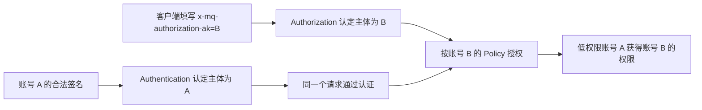

#### 问题代码

问题来自同一个请求中存在两套相互独立的身份字段。

第一步，Authentication Builder 从标准 `authorization` Metadata 中解析 Credential，
得到账号 A，并使用 A 的密码校验签名：

```java
String authorization =
    metadata.get(GrpcConstants.AUTHORIZATION);
// ...
if (CREDENTIAL.equals(authItem)) {
    String[] credential =
        kv[1].split(CommonConstants.SLASH);
    context.setUsername(credential[0]); // 账号 A
}
```

第二步，Authentication Pipeline 尝试把认证主体 A 发布到
`x-mq-authorization-ak`，但使用的是“字段不存在才写入”：

```java
if (StringUtils.isNotBlank(
    defaultAuthenticationContext.getUsername())) {
    GrpcUtils.putHeaderIfNotExist(
        headers,
        GrpcConstants.AUTHORIZATION_AK,
        defaultAuthenticationContext.getUsername());
}
```

`putHeaderIfNotExist` 的实现如下：

```java
if (!headers.containsKey(key) && value != null) {
    headers.put(key, value);
}
```

gRPC 客户端能够在请求 Metadata 中预先携带
`x-mq-authorization-ak=B`，而 Header Interceptor 没有删除该字段。因此
`headers.containsKey(AUTHORIZATION_AK)` 为 true，账号 A 不会覆盖客户端填写的账号 B。

第三步，Authorization Builder 不读取 AuthenticationContext，而是重新从 Metadata 读取
`x-mq-authorization-ak`：

```java
Subject subject = null;
if (metadata.containsKey(GrpcConstants.AUTHORIZATION_AK)) {
    subject = User.of(
        metadata.get(GrpcConstants.AUTHORIZATION_AK)); // 账号 B
}
```

最终，同一个请求的 Authentication Subject 是 A，Authorization Subject 却是 B：

```text
authorization Credential = A
authorization Signature  = 使用 A 的密码生成
x-mq-authorization-ak     = B

Authentication            = 按 A 验签，通过
Authorization             = 按 B 查询 ACL
```

问题位置：

- `auth/src/main/java/org/apache/rocketmq/auth/authentication/builder/DefaultAuthenticationContextBuilder.java:48`
- `proxy/src/main/java/org/apache/rocketmq/proxy/grpc/interceptor/HeaderInterceptor.java:39`
- `proxy/src/main/java/org/apache/rocketmq/proxy/grpc/pipeline/AuthenticationPipeline.java:53`
- `proxy/src/main/java/org/apache/rocketmq/proxy/common/utils/GrpcUtils.java:29`
- `auth/src/main/java/org/apache/rocketmq/auth/authorization/builder/DefaultAuthorizationContextBuilder.java:566`

#### 出现原因

认证和授权分别读取了两个身份来源：Authentication 使用签名中的 AccessKey，
Authorization 使用客户端可写 Metadata。系统没有规定“认证主体字段只能由服务端产生”，
导致两个阶段可以看到不同用户。

#### 可选方案与最终建议

| 方案 | 取舍 |
| --- | --- |
| 认证前清除字段，认证成功后由服务端回填 | 兼容 Pipeline，改动较小 |
| 客户端携带保留身份字段时直接拒绝 | 边界严格，但可能影响现有客户端或中间层 |
| 通过仅服务端可写的 Context 传递 Subject | 设计最清晰，不再依赖可变 Metadata；改动范围较大 |

**最终建议**：使用“清除并由服务端回填”；长期迁移到服务端 Context，取消通过
Metadata 在认证和授权之间传递主体。

#### 实现要点

1. Interceptor 清除客户端传入的授权身份字段。
2. Authentication Pipeline 再次清除该字段。
3. 认证成功后，仅由服务端写入实际认证用户名。
4. 认证白名单请求不发布未经验证的身份。

```java
Metadata metadata = GrpcConstants.METADATA.get(Context.current());
GrpcUtils.putHeader(metadata, GrpcConstants.AUTHORIZATION_AK, null);
AuthenticationContext authenticationContext =
    newContext(context, metadata, request);
authenticationEvaluator.evaluate(authenticationContext);
if (authConfig.isAuthenticationRequired(
    request.getDescriptorForType().getFullName())) {
    putAuthenticatedIdentity(metadata, authenticationContext);
}
```

写入值只取自已经通过 Authentication 的服务端 context：

```java
private void putAuthenticatedIdentity(
    Metadata metadata, AuthenticationContext context) {
    if (context instanceof DefaultAuthenticationContext) {
        DefaultAuthenticationContext authenticated =
            (DefaultAuthenticationContext) context;
        if (StringUtils.isNotBlank(authenticated.getUsername())) {
            GrpcUtils.putHeader(metadata,
                GrpcConstants.AUTHORIZATION_AK,
                authenticated.getUsername());
        }
    }
}
```

#### 验证要求

- 需要覆盖成功认证写入、客户端字段清理、白名单不发布身份，以及 Authorization
  在认证跳过时拒绝。
- 需要完成真实 gRPC 进程中的“低权限 A 冒充高权限 B”回归。
- 长期可改为通过服务端 Context 直接传递 Subject，减少对 Metadata 约定的依赖。

---

### S-04：允许开启授权而关闭认证，授权链缺少可信用户身份

- **结论**：已确认危险配置，P1。
- **状态**：待修复。

#### 问题与影响

`authorizationEnabled=true`、`authenticationEnabled=false` 时没有可信认证主体，
授权只能基于客户端声明或空主体，授权结果没有安全意义。

#### 出现原因

Authentication 和 Authorization 被设计为两个独立布尔开关，配置模型没有表达
“授权依赖可信认证主体”这一不变量。

#### 可选方案与最终建议

| 方案 | 取舍 |
| --- | --- |
| 检测到非法组合时启动失败 | 行为明确、默认安全，但错误配置会导致服务不可用 |
| 自动替运维开启 Authentication | 服务可启动，但系统悄悄改变运维意图和认证要求 |
| 允许启动，仅在请求阶段拒绝 | 可作为纵深防线，但故障发现太晚 |

**最终建议**：配置加载时直接拒绝非法组合，并在请求阶段再次 fail-closed；不自动修改
运维配置。

#### 实现要点

- `AuthConfig.validate()` 在启动和配置加载阶段直接拒绝该组合。
- Broker、Proxy Remoting、Proxy gRPC 的 Authorization Pipeline 在请求阶段再次
  fail-closed。
- 不自动替运维开启 Authentication，避免进程以非预期配置继续运行。

```java
if (authorizationEnabled && !authenticationEnabled) {
    throw new IllegalArgumentException(
        "authorization requires authentication to be enabled");
}
```

关键位置：

- `auth/src/main/java/org/apache/rocketmq/auth/config/AuthConfig.java:91`
- `proxy/src/main/java/org/apache/rocketmq/proxy/grpc/pipeline/AuthorizationPipeline.java:65`

即使第三方构造 `AuthConfig` 时漏调 `validate()`，生产 Pipeline 还应提供请求级兜底：

```java
private void ensureAuthenticatedSubject(GeneratedMessageV3 request) {
    String rpcCode = request.getDescriptorForType().getFullName();
    if (!authConfig.isAuthenticationEnabled()) {
        throw new AuthenticationException(
            "Authorization requires authentication for request:{}.", rpcCode);
    }
}
```

#### 验证要求

- 需要覆盖配置校验、Proxy 启动失败和三个 Pipeline 的运行时拒绝。
- 这是有意的安全不兼容：错误配置会启动失败，而不是继续提供不可信授权。

---

### S-05：认证与授权白名单错位，使未认证请求进入授权链

- **结论**：已确认危险配置，P1。
- **状态**：待修复。

#### 问题与影响

若某 RPC 在 `authenticationWhitelist` 中、却不在 `authorizationWhitelist` 中，
该请求会跳过认证但仍进入授权，授权主体未经验证。

#### 出现原因

两个白名单独立配置和更新，没有包含关系校验，也没有以同一原子快照发布。

#### 可选方案与最终建议

| 方案 | 取舍 |
| --- | --- |
| 自动把认证白名单合并进授权白名单 | 使用简单，但会静默扩大免授权范围 |
| 拒绝不满足包含关系的配置 | 不会扩大权限，错误能尽早暴露 |
| 合并成一个统一白名单/原子配置对象 | 长期模型更简单，但涉及配置兼容 |

**最终建议**：要求 `authenticationWhitelist ⊆ authorizationWhitelist`，非法配置直接
拒绝；请求阶段保留兜底。长期将相关配置作为一个原子快照发布。

#### 实现要点

Authorization 开启时要求：

```text
authenticationWhitelist ⊆ authorizationWhitelist
```

配置加载时校验，三个生产 Pipeline 还会逐请求检查，运行时出现短暂错位时直接拒绝。

关键位置：`auth/src/main/java/org/apache/rocketmq/auth/config/AuthConfig.java:95`

```java
Set<String> authenticationWhitelistSet = entries(authenticationWhitelist);
Set<String> authorizationWhitelistSet = entries(authorizationWhitelist);
if (authorizationEnabled
    && !authorizationWhitelistSet.containsAll(authenticationWhitelistSet)) {
    Set<String> unprotectedRpcCodes =
        new LinkedHashSet<>(authenticationWhitelistSet);
    unprotectedRpcCodes.removeAll(authorizationWhitelistSet);
    throw new IllegalArgumentException(
        "authenticationWhitelist entries must also be included "
            + "in authorizationWhitelist: " + unprotectedRpcCodes);
}
```

请求到达 Pipeline 后还应检查具体 RPC，防止运行时修改白名单时出现短暂错位：

```java
if (!authConfig.isAuthenticationRequired(rpcCode)
    && authConfig.isAuthorizationRequired(rpcCode)) {
    throw new AuthenticationException(
        "Authorization requires authentication for request:{}.", rpcCode);
}
```

#### 验证要求

- 需要补充 `AuthConfigTest` 和 Broker/Proxy Pipeline 回归。
- 两个白名单的程序化更新不是原子操作，短暂错位可能造成请求被拒绝，但不会放行。

---

### S-06：空 AuthorizationContext 被直接放行，未映射请求可绕过 ACL

- **结论**：已确认系统性 fail-open，High/P1。
- **状态**：待修复；修复时必须区分“已知无资源”和“未知/未解析”。

#### 问题与影响

公开入口对空上下文直接返回：

```java
public void evaluate(List<AuthorizationContext> contexts) {
    if (CollectionUtils.isEmpty(contexts)) {
        return;
    }
}
```

因此任何未来的 Registry 漏初始化、Builder 漏分支、body 解析遗漏或未知
RequestCode，都可能自动变成 ACL 绕过。E-01 和 E-02 正是被这一行为放大的具体案例。

#### 出现原因

该接口把空 context 同时解释为“无需授权”和“Builder 未识别资源”，无法区分合法无资源
请求与未知授权语义，并选择了默认放行。

#### 可选方案与最终建议

| 方案 | 取舍 |
| --- | --- |
| 空 context 全部放行 | 兼容性最好，但任何映射遗漏都会变成绕过 |
| 空 context 全部拒绝 | 默认安全，但会误拒合法无资源控制帧 |
| 默认拒绝，先识别请求语义，再使用独立的兼容白名单 | 已知接口可兼容，未知请求始终拒绝；需要维护语义注册 |

**最终建议**：生产 Pipeline 使用携带 `rpcCode` 的严格入口，空 context 默认拒绝；
先把请求分类为“已解析资源”“已知无资源”或“未知/未解析”，其中未知/未解析必须在查询
任何白名单前拒绝。独立白名单默认空，只用于已知接口的明确兼容场景。
`evaluate(List)` 应废弃或降低可见性。

#### 实现要点

生产 Pipeline 改用携带 `rpcCode` 的严格入口：

```java
if (CollectionUtils.isEmpty(contexts)) {
    if (!authConfig.isAuthorizationRequired(rpcCode)
        || authConfig.isAuthorizationEmptyContextAllowed(rpcCode)) {
        return;
    }
    throw new AuthorizationException(...);
}
```

关键位置：
`auth/src/main/java/org/apache/rocketmq/auth/authorization/AuthorizationEvaluator.java:42`

严格入口还必须先确认 `rpcCode` 具有已知授权语义。若只按字符串查询白名单，运维把未知
code/descriptor 写入普通 Authorization 白名单或空上下文白名单时，未知请求仍可能被
放行。实现必须先判定 `UNRESOLVED`，再处理白名单。

生产 Pipeline 必须调用携带 `rpcCode` 的严格入口，而不是缺少请求语义的列表重载：

```java
ensureAuthenticatedSubject(request);
List<AuthorizationContext> contexts =
    newContexts(context, headers, request);
authorizationEvaluator.evaluate(
    request.getDescriptorForType().getFullName(), contexts);
```

代表调用点：
`proxy/src/main/java/org/apache/rocketmq/proxy/grpc/pipeline/AuthorizationPipeline.java:50`

对已经确认语义的请求，只有两种情况可以接受空上下文：

1. 整个 API 已在正常 Authorization 白名单中；
2. RequestCode 被显式加入独立的 `authorizationEmptyContextWhitelist`。

该独立白名单默认空，并且只对空上下文生效；请求一旦带资源，仍必须执行正常 ACL。
未知 RequestCode 或 gRPC method descriptor 不属于这两种情况，即使误配到白名单也必须
拒绝。

#### 验证要求

- 需要验证 Broker、Proxy Remoting、Proxy gRPC 三个生产 Pipeline 都调用严格入口，并
  证明未知 RequestCode/method descriptor 在普通白名单、空上下文白名单和两者同时配置
  时都被拒绝。
- `evaluate(List)` 可能被调用方误用，应删除、降低可见性或标记废弃。
- gRPC 合法无资源控制帧需要完成建模，见 R-07；这是发布兼容阻断项。

---

### S-07：Body 资源和部分 RequestCode 未映射，相关请求缺少正确授权

- **结论**：已确认授权语义遗漏，High。
- **状态**：待修复。

#### 问题与影响

Builder 的显式 RequestCode 映射不完整，而注解兜底只能读取
`CommandCustomHeader`。资源放在 body、extFields 或客户端生命周期数据中的请求如果没有
专门分支，就会生成空 context；Evaluator 对空 context 直接返回会造成授权绕过。

#### 出现原因

1. RequestCode 语义分散在多个 Processor，Builder 依赖人工同步；
2. Header 注解模型看不到 body 中的单资源或资源列表；
3. 没有“所有 Broker 可执行 RequestCode 必须具备授权语义”的覆盖完整性测试；
4. 空 context 过去默认放行，使映射遗漏从功能缺陷放大为安全问题。

#### 已识别的授权语义

| 资源载体 | RequestCode | Resource / Action |
| --- | --- | --- |
| Header/extFields | `LITE_PULL_MESSAGE` | Topic + Group `SUB` |
| Header/extFields | `SEND_REPLY_MESSAGE(_V2)` | Topic `PUB` |
| Header/extFields | Remoting `HEART_BEAT`、`UNREGISTER_CLIENT` | Producer Group `PUB`；Consumer Group `SUB` |
| Body 单资源 | `QUERY_ASSIGNMENT`、`SET_MESSAGE_REQUEST_MODE`、`CHECK_CLIENT_CONFIG` | Topic + Group `SUB` |
| Body 资源列表 | `BATCH_ACK_MESSAGE` | 每个 Ack 的 Topic + Group `SUB` |
| Body 资源列表 | `UPDATE_AND_CREATE_TOPIC_LIST` | 每个 Topic `CREATE`；Retry Topic 转 Group |
| Broker 全局快照 | `GET_ALL_TOPIC_CONFIG`、`GET_ALL_SUBSCRIPTIONGROUP_CONFIG` | Cluster `GET` |

E-02 已单独分析外部反馈点名的 Broker Admin 接口，本项不再重复罗列那组接口。

#### 可选方案与最终建议

| 方案 | 取舍 |
| --- | --- |
| 在 Builder 中逐分支解码 Header/body | 能兼容旧协议，短期改动可控；仍依赖人工维护 |
| 把所有资源迁移到带注解的类型化 Header | 注解模型统一，但协议兼容和客户端改造范围大 |
| 建立集中式 RequestCode 授权语义注册表 | 可做完整性检查并统一 Header/body 解析；需要专项设计 |

**最终建议**：短期保留兼容协议，在 Builder 中显式解码并为 body 中每个资源生成 context；
同时建立 RequestCode 完整性测试。长期把授权语义收敛到集中注册表，未知或未登记语义默认
拒绝。

#### 实现要点

关键位置：
`auth/src/main/java/org/apache/rocketmq/auth/authorization/builder/DefaultAuthorizationContextBuilder.java:349`

body 中携带资源的请求必须先解码 body，再逐项构造标准 context。例如
`BATCH_ACK_MESSAGE`：

```java
case RequestCode.BATCH_ACK_MESSAGE: {
    BatchAckMessageRequestBody body =
        BatchAckMessageRequestBody.decode(
            command.getBody(), BatchAckMessageRequestBody.class);
    if (body != null && CollectionUtils.isNotEmpty(body.getAcks())) {
        for (BatchAck ack : body.getAcks()) {
            addSubContexts(result, subject,
                ack.getConsumerGroup(), ack.getTopic(), sourceIp);
        }
    }
    break;
}
```

批量创建 Topic 也不能只构造一个笼统的 Cluster context，而要覆盖 body 中的每个资源：

```java
case RequestCode.UPDATE_AND_CREATE_TOPIC_LIST: {
    CreateTopicListRequestBody body =
        CreateTopicListRequestBody.decode(
            command.getBody(), CreateTopicListRequestBody.class);
    for (TopicConfig config : body.getTopicConfigList()) {
        String topicName = config.getTopicName();
        Resource resource = NamespaceUtil.isRetryTopic(topicName)
            ? Resource.ofGroup(topicName)
            : Resource.ofTopic(topicName);
        result.add(DefaultAuthorizationContext.of(
            subject, resource, Action.CREATE, sourceIp));
    }
    break;
}
```

#### 修复边界

- 只有“既是资源字段、又是协议必填字段”的值为空时才直接拒绝。
- 协议原本允许不传的字段，不应为了 ACL 普遍改成业务必填。
- 资源为空不是所有 API 的统一业务错误；统一安全边界由 S-06 的严格 Evaluator 负责。
- 严格 Evaluator 只能防止空上下文绕过，不能代替正确的细粒度资源语义。

#### 验证要求

- Builder 定向测试需要覆盖上述主要分支。
- 需要完成真实 Broker/Proxy 的 allow/deny 矩阵。
- 必须与严格空 context 策略一起验证，否则合法请求可能被误拒或权限粒度不正确。

---

### S-08：授权层检查临时用户而非真实用户，禁用账号仍可能通过

- **结论**：已确认授权错误，Medium。
- **状态**：待修复。

#### 问题与影响

`UserAuthorizationHandler` 检查请求 Subject 临时构造的 `User`，而不是
Metadata Provider 查询到的真实用户。临时对象通常没有 `UserStatus`，因此用户禁用后，
授权层不能可靠拒绝。

#### 出现原因

请求 Subject 和 Provider 返回的持久化 User 使用了同一模型类型，代码在异步回调中混用了
两个对象，把状态判断落到了仅含用户名的临时 Subject 上。

#### 可选方案与最终建议

- **只依赖认证层检查**：路径简单，但缓存命中或非标准调用链可能绕过最新状态；
- **授权层再次检查 Provider 返回的真实 User**：能作为纵深防线，增加一次元数据读取；
- **用户状态变化时主动失效认证/授权缓存**：可实现立即吊销，但需要事件机制。

**最终建议**：授权层检查 Provider 返回对象；如果产品要求禁用立即生效，再配合缓存主动
失效，而不是删除授权层的状态检查。

#### 实现要点

改为检查 Provider 返回值：

```java
User user = (User) subject;
return authenticationMetadataProvider.getUser(user.getUsername())
    .thenApply(result -> {
        if (result == null) {
            throw new AuthorizationException(
                "User:{} not found.", user.getUsername());
        }
        if (result.getUserStatus() == UserStatus.DISABLE) {
            throw new AuthenticationException(
                "User:{} is disabled.", user.getUsername());
        }
        return result;
    });
```

关键位置：
`auth/src/main/java/org/apache/rocketmq/auth/authorization/chain/UserAuthorizationHandler.java:56`

#### 验证要求

- 需要覆盖“持久化用户为 DISABLE 时拒绝”的单测。
- 该问题主要影响认证缓存命中、非标准调用链及历史上“只授权不认证”的错误配置；标准
  未缓存认证链已经检查禁用状态。
- 需要补充“认证成功 → 禁用用户 → 同一连接继续请求”的端到端测试。
- Stateful 缓存的主动失效问题见 R-03。

---

### S-09：DENY 排在 ALLOW 之后，同等精度规则可能被错误放行

- **结论**：已确认条件性权限放宽，Low/P2。
- **状态**：待修复。

#### 问题与影响

调用方排序后使用 index 0 作为最终规则，但 Comparator 会把同等精度的
`DENY` 排在 `ALLOW` 后；同 Decision 时也可能返回非 0，违反 Comparator 契约。

最终决策只取排序后的第一项，因此 Comparator 的方向会直接改变授权结果：

```java
policyEntries.sort(this::comparePolicyEntries);
return policyEntries.get(0);
```

#### 出现原因

Comparator 同时承担“资源匹配精度排序”和“相同精度下的决策优先级”，DENY 的排序方向写反，
同 Decision 又没有返回 0，最终使排序第一项不稳定。

#### 可选方案与最终建议

- **修正 Comparator**：改动最小，保留现有选取流程；
- **不排序，直接扫描并计算最优规则**：语义更直观，但改动范围更大；
- **策略写入时禁止冲突规则**：能减少歧义，但不能替代运行时确定性决策。

**最终建议**：先修正 Comparator 并覆盖比较器契约、等精度 DENY/ALLOW 和顺序无关性；
策略写入阶段可额外提示冲突，但不作为唯一防线。

#### 实现要点

```java
if (d1 == d2) {
    return 0;
}
if (d1 == Decision.DENY) {
    return -1;
}
return d2 == Decision.DENY ? 1 : 0;
```

关键位置：
`auth/src/main/java/org/apache/rocketmq/auth/authorization/chain/AclAuthorizationHandler.java:105`

#### 验证要求

- 需要覆盖 Comparator 契约和同等精度 DENY 覆盖 ALLOW。
- 需要补充真实持久化 Provider 的集成测试。

---

### S-10：BrokerContainer 两个控制端口未安装 ACL，管理请求可直接执行

- **结论**：已确认漏洞，High/P0。
- **状态**：待修复。

#### 问题与影响

BrokerContainer 的普通控制端口和 fast 控制端口可以直接到达
`ADD_BROKER`、`REMOVE_BROKER`、`GET_BROKER_CONFIG`、
`UPDATE_BROKER_CONFIG` 等操作，但没有安装标准 Authentication/Authorization Pipeline。

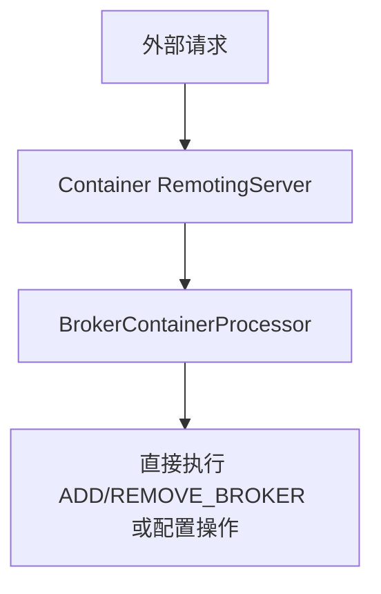

#### 出现原因

BrokerContainer 自建普通和 fast 两套 RemotingServer，却没有复用 Broker 的 Pipeline
初始化；设计上又隐含依赖“控制端口只在内部网络可达”的部署假设。

#### 可选方案与最终建议

- **两个端口统一安装标准 Pipeline**：授权机制一致，不侵入 Processor；
- **只依赖网络隔离**：可作为纵深措施，但端口一旦暴露就没有应用层保护；
- **在每个 Container 业务分支单独判断权限**：重复且容易遗漏。

**最终建议**：两个端口统一安装标准 Authentication/Authorization Pipeline，网络隔离
保留为部署层纵深防御。

#### 实现要点

两个 RemotingServer 都安装与 Broker 一致的认证、授权 Pipeline；Container
控制操作按 Container Cluster 资源授权，避免给每个业务分支重复写 ACL 判断。

关键位置：`container/src/main/java/org/apache/rocketmq/container/BrokerContainer.java:302`

```java
private void initializeRequestPipeline() {
    RequestPipeline pipeline = (ctx, request) -> {
    };
    pipeline = pipeline
        .pipe(new AuthorizationPipeline(this.containerAuthConfig))
        .pipe(new AuthenticationPipeline(this.containerAuthConfig));

    this.remotingServer.setRequestPipeline(pipeline);
    this.fastRemotingServer.setRequestPipeline(pipeline);
}
```

同一条标准 Pipeline 应同时设置到普通端口和 fast 端口；Processor 中无需重复判断用户权限。

#### 验证要求

- 需要覆盖 Container 控制面两个端口的定向 ACL 测试。
- 需要验证两个控制端口在真实网络暴露条件下的拒绝和允许行为。

---

### S-11：Factory configName 冲突，不同 Broker 可能共用用户和 ACL 运行时

- **结论**：已确认条件性漏洞，Critical/P0。
- **状态**：待修复。

#### 问题与影响

Authentication/Authorization Factory 使用静态 Map 按 `configName` 缓存 Provider、
Evaluator 和 Manager。BrokerContainer 内多个 Broker 若得到相同 `configName`，会共用
错误的认证、授权运行时。

Factory 的缓存键只区分类型前缀和 `configName`：

```java
return computeIfAbsent(
    METADATA_PROVIDER_PREFIX + config.getConfigName(),
    key -> {
        // create metadata provider
    });
```

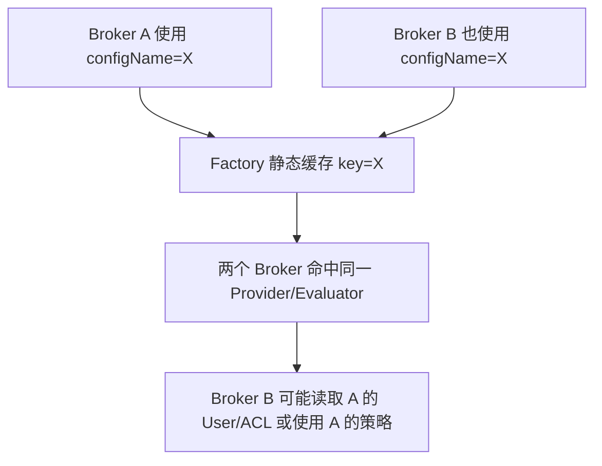

#### 出现原因

进程级静态 Factory 把业务配置字段 `configName` 当作运行实例唯一标识，但该字段在
BrokerContainer 多实例和实例重建场景中并不天然唯一。

#### 可选方案与最终建议

- **生成带 Container/Broker 身份的唯一 key**：改动集中，兼容静态 Factory；
- **Factory 改为实例级对象**：从结构上消除全局碰撞，改动范围较大；
- **只依靠运行代次 handle**：能解决重建所有权，不能解决不同业务实例初始同名。

**最终建议**：为 Container 控制面和每个子 Broker 生成作用域唯一、能够区分运行
代次的 key，解决本项的同名碰撞。运行代次释放所有权问题单独见 S-13；长期移除全局静态
缓存。

#### 实现要点

Container 控制面和子 Broker 使用不同的唯一 key：

- 控制面 key 纳入 bind address、监听端口和运行代次；
- 子 Broker key 纳入父 Container key、Cluster、BrokerName 和 BrokerId。

关键位置：

- `container/src/main/java/org/apache/rocketmq/container/BrokerContainer.java`
- `auth/src/main/java/org/apache/rocketmq/auth/authentication/factory/AuthenticationFactory.java`
- `auth/src/main/java/org/apache/rocketmq/auth/authorization/factory/AuthorizationFactory.java`

```java
// Container 控制面：同一端口重建也使用新的运行代次。
String runtimeSuffix =
    ":" + Long.toHexString(AUTH_RUNTIME_SEQUENCE.incrementAndGet());
authConfig.setConfigName(
    "broker-container-control:" + bindAddress.length() + ":"
        + bindAddress + ":" + listenPort + runtimeSuffix);

// 子 Broker：同名 Master/Slave 继续由 brokerId 区分。
return "broker-container:" + containerConfigName.length() + ":"
    + containerConfigName + ":" + clusterName.length() + ":" + clusterName
    + ":" + brokerName.length() + ":" + brokerName
    + ":" + brokerIdentity.getBrokerId();
```

实际位置：

- `container/src/main/java/org/apache/rocketmq/container/BrokerContainer.java:151`
- `container/src/main/java/org/apache/rocketmq/container/BrokerContainer.java:677`

#### 验证要求

- 必须覆盖多 Broker、同 BrokerName 不同 BrokerId、实例重建和重复关闭。
- 同 BrokerName 的 Master/Slave 因 BrokerId 不同，修复后不应再发生 key 碰撞。
- Master/Slave 配置和数据是否一致属于独立的部署一致性问题。

---

### S-12：多个 Broker 共用本地 ACL 目录，数据、文件锁和生命周期互相干扰

- **结论**：已确认条件性漏洞，Critical/P0。
- **状态**：待修复。

#### 问题与影响

即使运行时 key 不同，多个 Broker 若仍使用同一个 `authConfigPath`，其 RocksDB 数据、
文件锁和关闭生命周期仍会互相影响。

#### 出现原因

原设计只隔离了 Factory 的逻辑运行时 key，没有同时隔离 Local Provider 使用的物理
RocksDB 根目录；逻辑实例不同并不代表文件存储自然分开。

#### 可选方案与最终建议

- **每个 Local Provider 实例使用独立目录**：隔离明确，适合本地存储；
- **多个 Broker 使用明确支持共享的外部 Metadata Provider**：可以集中管理，但引入外部依赖；
- **允许多个 Local Provider 共用目录**：会共享文件锁、后台线程和关闭生命周期，不可接受。

**最终建议**：Local Provider 必须使用独立 canonical path，发现冲突直接拒绝启动；确需
共享元数据时，使用具备并发和生命周期保证的外部 Provider，不能共享本地 RocksDB 目录。

#### 实现要点

Container 控制面使用基于 endpoint 的独立路径；子 Broker 默认使用自身
`storePathRootDir/config`，并在启动前比较 canonical path。若两个使用 Local Provider
的实例指向相同路径，直接拒绝启动。Provider 关闭还应改为终态，避免后台 reload 线程在
资源关闭后继续运行。

关键位置：

- `container/src/main/java/org/apache/rocketmq/container/BrokerContainer.java`
- `auth/src/main/java/org/apache/rocketmq/auth/authentication/provider/LocalAuthenticationMetadataProvider.java`
- `auth/src/main/java/org/apache/rocketmq/auth/authorization/provider/LocalAuthorizationMetadataProvider.java`
- `common/src/main/java/org/apache/rocketmq/common/config/AbstractRocksDBStorage.java`

Local Provider 实际会在同一根目录下分别打开 `users` 和 `acls` RocksDB；所以即使
Factory key 已隔离，共用根路径仍会共享数据和文件锁：

```java
this.storage = new ConfigRocksDBStorage(
    authConfig.getAuthConfigPath() + File.separator + "users");
```

建议在子 Broker 未显式配置路径时使用它自己的 Store 根目录：

```java
if (StringUtils.isBlank(authConfig.getAuthConfigPath())) {
    String targetPath =
        storeConfig.getStorePathRootDir() + File.separator + "config";
    ensureNoLegacyAuthMetadata(authConfig, targetPath);
    authConfig.setAuthConfigPath(targetPath);
}
ensureAuthConfigPathAvailable(authConfig, brokerIdentity);
```

```java
File authConfigPath =
    new File(authConfig.getAuthConfigPath()).getCanonicalFile();
File existingPath =
    new File(existingAuthConfig.getAuthConfigPath()).getCanonicalFile();
if (!authConfigPath.equals(existingPath)) {
    return;
}
boolean authenticationPathConflict =
    usesLocalAuthenticationMetadata(authConfig)
        && usesLocalAuthenticationMetadata(existingAuthConfig);
boolean authorizationPathConflict =
    usesLocalAuthorizationMetadata(authConfig)
        && usesLocalAuthorizationMetadata(existingAuthConfig);
if (authenticationPathConflict || authorizationPathConflict) {
    throw new IllegalStateException(
        "Broker cannot share local ACL metadata path " + authConfigPath);
}
```

实际位置：

- `auth/src/main/java/org/apache/rocketmq/auth/authentication/provider/LocalAuthenticationMetadataProvider.java:49`
- `container/src/main/java/org/apache/rocketmq/container/BrokerContainer.java:602`
- `container/src/main/java/org/apache/rocketmq/container/BrokerContainer.java:636`

终态关闭应由存储对象内部状态保证，`shutdownAndStopReload()` 无需通过布尔返回值表达
结果。`AbstractRocksDBStorage` 的终态关闭和 `ThreadPoolMonitor` 的资源释放应共同保证
实例关闭后不再残留 reload 任务。

#### 验证要求

- 需验证多个 Broker 使用默认路径时生成不同目录，并能同时读写各自元数据。
- 需验证两个 Local Provider 显式配置相同 canonical path 时启动失败。
- 需验证 External Provider 不被本地路径冲突逻辑误判。
- 需验证实例关闭后 reload 线程终止、同路径实例能够重建，且关闭一个实例不影响另一个
  实例。

---

### S-13：前一代实例关闭可误删新实例的认证授权运行时

- **结论**：已确认生命周期竞争，Critical/P0。
- **状态**：待修复。

#### 问题与影响

同一逻辑实例重建后，generation-1 对象若延迟执行 `release(configName)`，可能删除静态 Map
中已经属于新一代实例的 Provider/Evaluator。

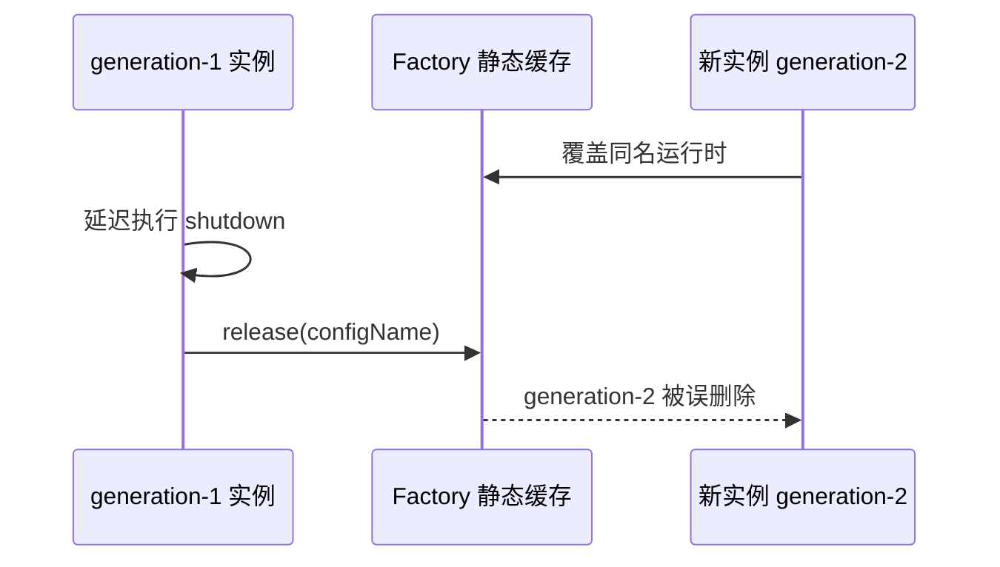

#### 出现原因

全局 Factory 的释放所有权只用 `configName` 表达，没有携带“这次 release 属于哪一代
运行实例”的信息；generation-1 和 generation-2 对象因此可以操作同一个 Map 条目。

#### 可选方案与最终建议

- **RuntimeHandle/generation token**：创建时返回所有权 handle，关闭时 compare-and-remove；
- **仅在 Map 中做对象 identity compare-remove**：可行，但仍需要调用方持有预期对象；
- **移除全局静态 Factory**：结构最彻底，改造范围最大。

**最终建议**：所有生产生命周期必须保存并释放对应 `RuntimeHandle`；无 token 的
`release(AuthConfig)` 应删除，或限制为不可被生产代码调用的内部测试清理入口。长期与
S-11 一起移除全局静态缓存。

#### 修复要点

创建运行时必须返回 `RuntimeHandle`，生产生命周期保存该 handle，并在关闭时携带它执行
compare-and-remove。只有 Map 中仍是预期 token 时才删除；复合检查与删除必须使用同一把
Map 锁，避免 check/remove 竞争：

```java
public static void release(RuntimeHandle expectedRuntimeHandle) {
    if (expectedRuntimeHandle == null
        || expectedRuntimeHandle.runtimeToken == null) {
        return;
    }
    release(expectedRuntimeHandle.configName,
        expectedRuntimeHandle, true);
}

if (checkExpectedRuntime && (expectedRuntimeHandle == null
    || INSTANCE_MAP.get(runtimeTokenKey)
        != expectedRuntimeHandle.runtimeToken)) {
    return;
}
```

只携带 `AuthConfig/configName` 的释放入口无法证明运行代次，存在无条件删除同名新代
运行时的问题：

```java
public static void release(AuthConfig config) {
    if (config == null) {
        return;
    }
    release(config.getConfigName(), null, false);
}
```

生产代码不能调用该入口。例如 Proxy 关闭路径也必须保存并释放对应的
`RuntimeHandle`，不能只传 `AuthConfig`：

```java
static void releaseAuthConfig(AuthConfig authConfig) {
    try {
        AuthenticationFactory.release(authConfig);
    } finally {
        AuthorizationFactory.release(authConfig);
    }
}
```

关键位置：

- `auth/src/main/java/org/apache/rocketmq/auth/authentication/factory/AuthenticationFactory.java:123`
- `auth/src/main/java/org/apache/rocketmq/auth/authorization/factory/AuthorizationFactory.java:127`
- `proxy/src/main/java/org/apache/rocketmq/proxy/ProxyStartup.java:239`
- `container/src/main/java/org/apache/rocketmq/container/BrokerContainer.java:687`

#### 验证要求

- 需要验证 generation-1 的 `RuntimeHandle` 不能释放 generation-2 运行时。
- 需要覆盖 Proxy 使用稳定 `configName=proxy:<proxyName>` 重建后，generation-1 Proxy
  延迟关闭的 generation 竞争。
- 无 token 的强制释放必须限制在明确的内部清理或测试路径。
- 这部分同步只保护静态运行时 Map 的复合生命周期，不应扩大到业务请求流程。

---

### S-14：白名单请求污染 Stateful 缓存，受保护 RPC 可能复用免认证/授权结果

- **结论**：已确认条件性漏洞，High。
- **状态**：待修复。

#### 问题与影响

Stateful Strategy 先查询缓存、后判断白名单。白名单请求产生或复用的结果可能被后续
受保护 RPC 命中，造成“白名单成功”跨请求传播。

#### 出现原因

白名单判断晚于缓存读取，而缓存 key 又不包含 `rpcCode` 或“本次请求是否受保护”的语义，
使不同 RPC 共享同一个认证/授权结果。

#### 可选方案与最终建议

- **白名单判断前置**：只有受保护请求进入缓存，改动最小；
- **把 rpcCode 加入缓存 key**：降低跨 RPC 复用，但白名单结果仍不应缓存；
- **对白名单请求完全禁用 Stateful Strategy**：语义正确，本质仍要求先判断白名单。

**最终建议**：先判断本次 RPC 是否需要认证/授权，只有受保护请求才能读写缓存；不把
“白名单成功”作为可缓存的安全结果。

#### 实现要点

白名单判断移动到缓存逻辑之前：

```java
public void evaluate(AuthenticationContext context) {
    if (!authConfig.isAuthenticationRequired(context.getRpcCode())) {
        doEvaluate(context);
        return;
    }
    if (StringUtils.isBlank(context.getChannelId())) {
        doEvaluate(context);
        return;
    }
    Pair<Boolean, AuthenticationException> result =
        authCache.get(buildKey(context), key -> {
            // 只有受保护请求才会进入缓存
            // ...
        });
}
```

`doEvaluate` 内部会再次判断 `isAuthenticationRequired`；白名单请求在此直接返回，不调用
Provider，也不写入缓存。

这一步必须发生在 `authCache.get(...)` 之前，因为 Authentication 缓存 key 本身不含
`rpcCode`：

```java
return ctx.getChannelId()
    + CommonConstants.POUND
    + ctx.getUsername();
```

Authorization Strategy 使用相同顺序；其 key 虽包含资源和动作，同样不包含
`rpcCode`，因此也必须先处理本次 RPC 的白名单语义。

关键位置：

- `auth/src/main/java/org/apache/rocketmq/auth/authentication/strategy/StatefulAuthenticationStrategy.java:44`
- `auth/src/main/java/org/apache/rocketmq/auth/authorization/strategy/StatefulAuthorizationStrategy.java:44`

#### 验证要求

- 需要覆盖 Authentication/Authorization 白名单缓存隔离。
- 用户禁用和 ACL 变更的 TTL 延迟属于独立的吊销一致性问题。

---

### S-15：动态更新白名单不生效，若按请求重新解析又会造成性能损耗

- **结论**：已确认配置正确性和性能问题；不是独立越权 PoC。
- **状态**：待修复。

#### 问题与影响

Strategy 在构造时缓存白名单，动态更新后可能继续使用过期值。直接改成每个请求解析字符串
虽然能解决陈旧数据，却会给认证热路径增加重复 split/trim/Set 构造开销。

#### 出现原因

Strategy 构造时缓存了从配置派生出的白名单集合，但配置更新没有同步重建 Strategy；按请求
重新解析字符串只是修正陈旧状态的补丁，会把成本转移到热路径。

#### 可选方案与最终建议

- **配置变化时重建 Strategy**：语义完整，但涉及 Factory 和运行时切换；
- **每个请求解析白名单字符串**：实现简单，持续消耗 CPU 和对象分配；
- **setter 解析并发布不可变快照**：更新成本集中，请求只做 `Set.contains`。

**最终建议**：setter 解析一次，以 `volatile` 不可变快照原子发布；请求路径不重复解析。

#### 实现要点

在白名单 setter 中解析一次，发布不可变的 `volatile WhitelistSnapshot`；请求路径只做
`Set.contains(rpcCode)`。

```java
private volatile WhitelistSnapshot authenticationWhitelist;

public void setAuthenticationWhitelist(String value) {
    this.authenticationWhitelist = WhitelistSnapshot.of(value);
}

private static final class WhitelistSnapshot {
    private final String value;
    private final Set<String> entries;

    private WhitelistSnapshot(String value) {
        this.value = value;
        this.entries = parseWhitelist(value);
    }
}
```

请求热路径应只读取一次 snapshot 并查询不可变 Set，不再重复
`split/trim/Set` 构造：

```java
private static boolean contains(
    WhitelistSnapshot snapshot, String rpcCode) {
    return snapshot != null
        && StringUtils.isNotEmpty(rpcCode)
        && snapshot.entries.contains(rpcCode);
}
```

关键位置：

- `auth/src/main/java/org/apache/rocketmq/auth/config/AuthConfig.java:106`
- `auth/src/main/java/org/apache/rocketmq/auth/config/AuthConfig.java:126`
- `auth/src/main/java/org/apache/rocketmq/auth/config/AuthConfig.java:220`
- `auth/src/main/java/org/apache/rocketmq/auth/authentication/strategy/AbstractAuthenticationStrategy.java`
- `auth/src/main/java/org/apache/rocketmq/auth/authorization/strategy/AbstractAuthorizationStrategy.java`

#### 验证要求

- 需要覆盖运行时更新可见性和白名单匹配。
- 验收时应确认请求路径没有重复解析，也没有把 ACL 判断侵入业务 Processor。

---

### S-16：远程热改 AuthConfig 只改变配置值，认证授权运行时不会同步生效

- **结论**：已确认安全配置不一致，P2。
- **状态**：待修复。

#### 问题与影响

远程更新这些配置后，已经构造的 Factory、Provider、Evaluator、Pipeline 和存储不会整体
重建，导致“查询看到的配置”和“实际生效的安全行为”不一致。

#### 出现原因

通用 `Configuration` 只能更新属性值，而 AuthConfig 背后关联 Factory、Provider、
Evaluator、Pipeline、缓存和本地存储的完整生命周期。只改 Properties 无法原子重建这些
对象。

#### 可选方案与最终建议

- **禁止通过通用接口热改 AuthConfig**：安全明确，需要受控重启；
- **实现版本化整体重建和原子切换**：可支持热更新，设计和验证成本高；
- **只开放少量真正无生命周期依赖的字段**：需要逐字段证明，容易形成例外。

**最终建议**：所有 AuthConfig 字段禁止走通用热改；如果产品确需热更新，单独设计
以下专用生命周期：

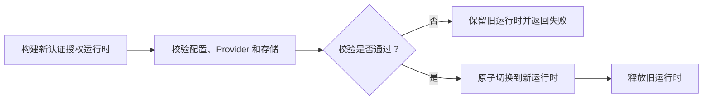

#### 实现要点

所有非静态 `AuthConfig` 字段禁止通过通用 Broker/Container 配置接口热改。若未来需要
支持，必须设计完整的版本化重建和切换生命周期，而不是只改 Properties。

Broker 与 Container 初始化黑名单时都从 `AuthConfig` 反射收集非静态字段，避免新增
安全配置后忘记手工补黑名单：

```java
for (Field field : AuthConfig.class.getDeclaredFields()) {
    if (!Modifier.isStatic(field.getModifiers())) {
        configBlackList.add(field.getName());
    }
}
```

实际更新入口在写入 `Configuration` 前拒绝：

```java
if (validateBlackListConfigExist(properties)) {
    response.setCode(ResponseCode.NO_PERMISSION);
    response.setRemark("Can not update config in black list.");
    return response;
}
brokerController.getConfiguration().update(properties);
```

关键位置：

- `broker/src/main/java/org/apache/rocketmq/broker/processor/AdminBrokerProcessor.java:255`
- `broker/src/main/java/org/apache/rocketmq/broker/processor/AdminBrokerProcessor.java:1053`
- `container/src/main/java/org/apache/rocketmq/container/BrokerContainerProcessor.java:62`
- `container/src/main/java/org/apache/rocketmq/container/BrokerContainerProcessor.java:258`

#### 验证要求

- 需要覆盖 Broker 和 Container 对 AuthConfig 字段的拒绝。
- 这是安全优先的兼容变化：相关配置必须通过受控重启或专用生命周期修改。

---

### S-17：被拒绝的敏感配置在黑名单校验前写入日志

- **结论**：已确认敏感日志风险，P2。
- **状态**：待修复。

#### 问题与影响

通用配置更新路径先记录请求 Properties，再判断字段是否禁止更新。即使更新最终被拒绝，
请求中携带的认证秘密也可能已经进入日志。

#### 出现原因

更新流程把“记录完整请求 Properties”放在安全校验之前；底层异常路径又直接拼接整个
Properties，没有统一的敏感字段分类和日志规则。

#### 可选方案与最终建议

- **校验前完全不记录配置值**：最安全，诊断信息较少；
- **统一敏感字段脱敏后记录**：保留诊断能力，但必须持续维护敏感字段集合；
- **只记录允许更新的 key，不记录 value**：兼顾审计和秘密保护。

**最终建议**：必须先完成权限和字段校验，拒绝请求不记录配置值，底层
异常也不拼接完整 Properties。进一步建议把成功更新日志收敛为只记录字段名；确需值日志时
统一走脱敏器。

#### 实现要点

Broker 更新入口应调整为先校验、再记录配置、最后更新；被拒绝的 Properties
不得进入后面的值日志：

```java
Properties properties = MixAll.string2Properties(bodyStr);
if (properties != null) {
    if (validateBlackListConfigExist(properties)) {
        response.setCode(ResponseCode.NO_PERMISSION);
        response.setRemark("Can not update config in black list.");
        return response;
    }
    LOGGER.info("updateBrokerConfig, new config: [{}] client: {} ",
        properties, callerAddress);
    brokerController.getConfiguration().update(properties);
}
```

Container 入口采用相同顺序。

修复时还必须保证 `Configuration#registerConfig(Properties)` 的异常日志不携带
`extProperties`，并在捕获中断后恢复线程中断状态：

```java
Thread.currentThread().interrupt();
log.error("registerConfig lock error", e);
```

关键位置：

- `broker/src/main/java/org/apache/rocketmq/broker/processor/AdminBrokerProcessor.java:1053`
- `container/src/main/java/org/apache/rocketmq/container/BrokerContainerProcessor.java:258`
- `remoting/src/main/java/org/apache/rocketmq/remoting/Configuration.java:101`
- `remoting/src/test/java/org/apache/rocketmq/remoting/ConfigurationTest.java:31`

#### 验证要求

- Broker/Container 测试需要覆盖黑名单字段拒绝。
- `ConfigurationTest` 应使用哑值验证异常日志不携带 Properties，并验证中断标志保留。
- 需要验证成功更新日志的字段级收敛，避免未来新增可更新秘密字段后再次泄露。

---

### S-18：非法 ACL 1.0 权限被迁移为 ALLOW + ALL，造成权限扩大

- **结论**：已确认权限升级问题，High/P2。
- **状态**：待修复。

#### 问题与影响

ACL 1.0 权限字符串不合法时，迁移逻辑可能落入宽松默认值，生成
`Decision.ALLOW` 和全部动作。

两段默认值组合后形成权限扩大：

```java
// 非空且不是 DENY 的任意字符串都会变成 ALLOW
return StringUtils.equals(str, AclConstants.DENY)
    ? Decision.DENY : Decision.ALLOW;

// 未知字符串又会获得 ALL
default:
    result.add(Action.ALL);
```

#### 出现原因

Decision 解析和 Action 解析分别使用宽松默认值：未知字符串先被视为 ALLOW，又在动作解析
中变成 ALL，两个局部默认叠加成最大权限。

#### 可选方案与最终建议

- **遇到非法值终止整次迁移**：最严格，但一条坏数据会阻断全部迁移；
- **跳过非法记录并告警**：不会授予权限，但目标侧可能缺少用户策略；
- **将非法记录迁移为 DENY 并输出报告**：默认安全，同时保留问题记录供运维修复。

**最终建议**：非法权限统一生成 DENY，并在迁移报告中记录账号、资源和
原始非法类型（不得记录秘密）；如需要整批失败语义，再提供显式严格模式，任何模式都不能
回退为 ALLOW。

#### 实现要点

只接受明确合法的 `PUB`、`SUB` 及合法组合；空值、未知值和非法组合统一迁移为
`Decision.DENY`，不得再用 ALLOW 兜底。

```java
private Decision parseDecision(String str) {
    if (StringUtils.isBlank(str)) {
        return Decision.DENY;
    }
    switch (StringUtils.trim(str)) {
        case AclConstants.PUB:
        case AclConstants.SUB:
        case AclConstants.PUB_SUB:
        case AclConstants.SUB_PUB:
            return Decision.ALLOW;
        default:
            return Decision.DENY;
    }
}
```

关键位置：
`auth/src/main/java/org/apache/rocketmq/auth/migration/AuthMigrator.java:193`

#### 验证要求

- `AuthMigratorTest` 需要覆盖合法和非法权限解析。
- 需要验证非法值会进入迁移告警/报告，并验证严格模式是否按设计终止迁移。

---

### S-19：gRPC 签名只绑定时间，可跨 RPC 和请求体重放

- **结论**：已确认协议弱点，High。
- **状态**：待修复；需同时确定协议升级和兼容策略。

#### 问题与影响

gRPC 签名内容主要绑定 datetime，没有同时绑定：

- RPC 方法；
- 请求体摘要；
- nonce；
- 可接受的时间窗口。

实际代码虽然把 RPC 名写入了 context，却没有把它加入签名内容；最终
`context.content` 只有客户端提供的 datetime：

```java
context.setRpcCode(
    request.getDescriptorForType().getFullName());
// 解析 Credential 与 Signature
// ...
context.setContent(
    datetime.getBytes(StandardCharsets.UTF_8));
```

认证处理器随后只对 `context.content` 计算签名：

```java
String signature = AclSigner.calSignature(
    context.getContent(), user.getPassword());
```

代码也没有对 datetime 做新鲜度校验。因此，只要密码没有变化，截获的签名不是
仅在一个有限时间窗口内有效，而是可能长期重放到另一个 RPC 或不同请求体。
Stateful Authentication 的 `channelId#username` 缓存还可能扩大复用窗口。

关键位置：

- `auth/src/main/java/org/apache/rocketmq/auth/authentication/builder/DefaultAuthenticationContextBuilder.java:48`
- `auth/src/main/java/org/apache/rocketmq/auth/authentication/chain/DefaultAuthenticationHandler.java:58`

#### 出现原因

协议没有定义版本化 canonical request，签名只覆盖 datetime；服务端又没有时间窗口和
nonce 状态，因此签名无法证明“调用了哪个 RPC、携带什么 body、是否为一次新请求”。

#### 可选方案与最终建议

| 方案 | 优点 | 缺点 |
| --- | --- | --- |
| 只增加 timestamp 时间窗口 | 改动最小，可限制长期重放 | 窗口内仍可跨 RPC、跨 body 重放 |
| 签名绑定 RPC 和 body digest | 阻止跨方法、跨内容复用 | 同一请求仍可在窗口内重复提交 |
| 版本化 canonical request + timestamp + nonce | 完整解决内容绑定和重放 | 需要客户端升级、nonce 存储及兼容期 |

**最终建议**：设计新版本签名串，绑定 RPC、AccessKey、timestamp、nonce 和 bodyDigest；
服务端校验时间窗口和 nonce 唯一性。原签名版本仅保留明确期限的兼容模式并产生告警，
Streaming RPC 单独定义握手和后续帧语义。

#### 建议的签名内容

引入版本化签名串，例如：

```text
version
rpcFullName
accessKey
timestamp
nonce
bodyDigest
```

服务端同时校验时间窗口和 nonce 去重；Streaming RPC 需要单独定义握手与后续帧语义。

#### 验证要求

- 代码静态证据明确，但需要补充完整重放 PoC 和协议兼容测试。
- “没有服务端时间窗口”来自源码检查；需要真实进程 PoC 验证完整利用链和中间层行为。
- Remoting 协议只保留为待验证风险，不能在没有 PoC 时与 gRPC 同级定性。
- 可以拆成协议版本专项实施，但在完成前不能宣称 ACL 重放风险已经关闭。

---

### S-20：`mqbroker -p` 明文输出初始化密码和内部客户端凭据

- **结论**：已确认的本地敏感信息泄露，Medium/P2；不是远程 ACL 绕过。
- **状态**：待修复。

#### 问题与影响

`mqbroker -p` 会把 `AuthConfig` 交给通用反射打印逻辑，其中包含初始化用户密码和
Broker/Proxy 内部客户端认证凭据。明文可能进入终端滚屏、自动化日志、工单附件或排障记录。

#### 出现原因

配置打印功能直接复用了运行时配置对象，没有把“调用者有权执行本地命令”和“敏感字段可以
明文输出”区分开，也没有复用 Broker 配置查询接口的字段级过滤策略。

#### 代码证据

```java
if (commandLine.hasOption('p') && configContext != null) {
    // 其他配置对象
    MixAll.printObjectProperties(
        console, configContext.getAuthConfig());
    System.exit(0);
}
```

`AuthConfig` 中包含 `initAuthenticationUser` 和
`innerClientAuthenticationCredentials`，打印前没有生成安全视图。

关键位置：
`broker/src/main/java/org/apache/rocketmq/broker/BrokerStartup.java:98`

#### 可选方案

| 方案 | 优点 | 缺点 |
| --- | --- | --- |
| A. 输出前删除或掩码敏感字段 | 改动小，保留排障价值 | 需要维护敏感字段清单 |
| B. `-p` 完全不输出 AuthConfig | 安全边界最简单 | 丢失非敏感认证配置的排障信息 |
| C. 建立敏感配置注解和统一安全打印器 | 长期一致性最好 | 影响范围较大 |

#### 最终建议

最终建议采用方案 A：复用 S-02 的敏感字段定义，默认只输出掩码后的安全视图，不提供明文
开关。长期可演进为方案 C，让 HTTP、Remoting、CLI 和日志共用同一套敏感字段策略。

#### 验证要求

捕获 CLI 标准输出，断言初始化密码和内部凭据的真实值均不存在，同时确认普通配置仍能正常
输出。

- 需检查其他 CLI、日志和配置导出入口是否复用同一敏感字段策略。
- 安全打印只解决输出泄露，不解决秘密仍以可读形式存在于配置对象和持久化文件中的问题。

---

## 三、后续迭代：其他风险、兼容性和部署边界

本节不纳入本次外部漏洞修复范围，也不把所有项目都定性为可直接利用的漏洞。每项分别说明
成立条件、产品取舍和建议边界。

### R-01：声明 Topic 与真实消息 Topic 不一致时，可能跨 Topic 读取或操作

- **结论**：潜在跨 Topic 风险，尚无完整利用 PoC。
- **状态**：待确认利用条件并补充一致性校验。

#### 问题与影响

ACL Pipeline 只能校验请求 Header 中声明的 Topic；`VIEW_MESSAGE_BY_ID`、
`END_TRANSACTION`、`RESUME_CHECK_HALF_MESSAGE` 等接口随后会按 Offset 或事务标识读取
真实消息。如果声明 Topic 与真实消息的逻辑 Topic 不一致，仅校验声明值就可能形成跨 Topic
读取或操作。

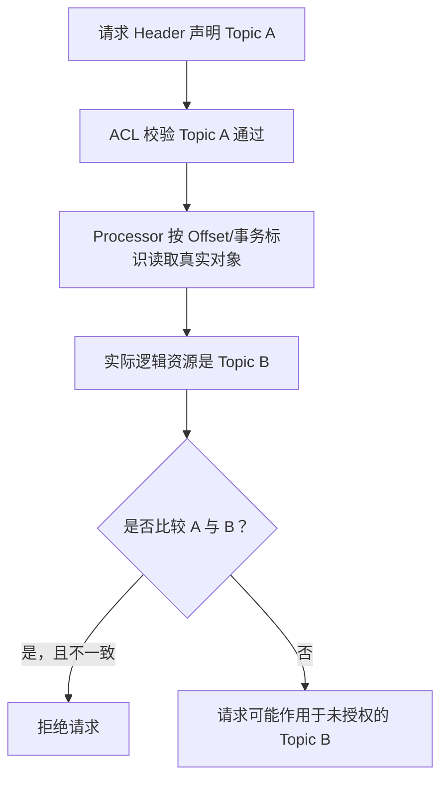

#### 出现原因

授权发生在读取消息之前，而真实资源只有业务 Processor 读取消息后才能确定。原流程在
“请求资源授权”和“真实对象解析”之间缺少一致性约束。

#### 修复要点

`QueryMessageProcessor`、`EndTransactionProcessor` 和 `AdminBrokerProcessor` 应在拿到
真实对象后，只比较请求声明 Topic 与真实逻辑 Topic。代表性实现：

```java
if (StringUtils.isNotBlank(requestHeader.getTopic())
    && !matchesRequestTopic(requestHeader.getTopic(), message)) {
    response.setCode(ResponseCode.NO_PERMISSION);
    response.setRemark("The topic does not match the message");
    return response;
}
```

涉及位置：

- `broker/src/main/java/org/apache/rocketmq/broker/processor/QueryMessageProcessor.java:152`
- `broker/src/main/java/org/apache/rocketmq/broker/processor/EndTransactionProcessor.java:220`
- `broker/src/main/java/org/apache/rocketmq/broker/processor/AdminBrokerProcessor.java:2858`

修复时不能采用以下两种越界方式：

1. 不能在 `AbstractTransactionalMessageCheckListener#sendCheckMessage` 中改写事务检查
   协议 Header：

   ```java
   checkTransactionStateRequestHeader.setTopic(
       msgExt.getUserProperty(MessageConst.PROPERTY_REAL_TOPIC));
   ```

   这不是“读取对象后做一致性判断”，而是改变原业务协议。

2. Proxy 事务路径不能先 `poll` 删除缓存数据，再比较 Topic：

   ```java
   TransactionData data =
       transactionDataManager.pollNoExpireTransactionData(
           producerGroup, transactionId);
   if (StringUtils.isNotBlank(topic)
       && !StringUtils.equals(topic, data.getTopic())) {
       return null;
   }
   ```

   这种顺序会让错误 Topic 请求先消费合法请求所需的事务状态。

对应位置：

- `broker/src/main/java/org/apache/rocketmq/broker/transaction/AbstractTransactionalMessageCheckListener.java:53`
- `proxy/src/main/java/org/apache/rocketmq/proxy/service/transaction/AbstractTransactionService.java:61`

#### 可选方案

| 方案 | 优点 | 缺点 |
| --- | --- | --- |
| A. Processor 只比较声明 Topic 与真实逻辑 Topic | 改动小；不复制 ACL；业务层最了解真实对象 | 每条相关接口都要补一个一致性检查 |
| B. Processor 对真实 Topic 再执行完整授权 | 能直接授权真实资源 | ACL 逻辑侵入业务层，容易与 Pipeline 产生双重语义 |
| C. 把 MessageStore 注入 ACL Pipeline | 授权逻辑集中 | 授权层依赖存储和业务协议，改动及性能影响最大 |

#### 最终建议

选择方案 A，职责保持为：

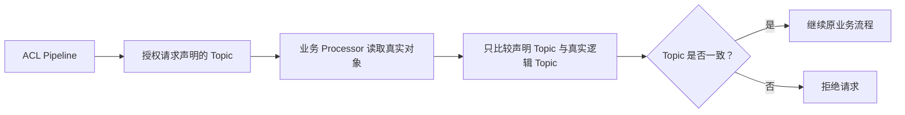

实现时还要遵守以下边界：

- 不修改 `AbstractTransactionalMessageCheckListener#sendCheckMessage` 的协议 Header；
- 不把 Schedule、Timer、事务、LMQ 等全部塞进一个通用 ACL helper。只有既有存储语义确实
  存在“物理 Topic → 逻辑 Topic”转换时，才在对应 Processor 内做转换并配套测试；
- Proxy 事务数据不能“先 `poll` 删除、再比较 Topic”。如需增加该校验，应在
  `TransactionDataManager` 内实现原子的 match-and-remove；否则保留原业务流程；
- Topic 为空时不在业务 Processor 中跳过整个授权流程，是否兼容由独立的空上下文策略控制。

#### 验证方式

三类接口分别覆盖 Topic 一致、不一致、消息不存在、解码失败和 Topic 为空；存在物理/逻辑
Topic 转换的分支必须单独覆盖。还要确认 Listener Header 未被改写、Proxy 错误 Topic 不会
消费事务状态。完整 PoC 完成前，本项仍按潜在风险管理。

---

### R-02：监听端口可直连时，客户端可伪造 PROXY Header 来源 IP 绕过 IP ACL

- **结论**：条件性 IP ACL 风险；能否利用取决于监听端口是否可被普通客户端直连。
- **状态**：待确认部署边界，并补代码级可信代理校验。

#### 问题与影响

gRPC 和 Remoting 收到合法 PROXY Header 后，会把 Header 中的 source address 作为 ACL
来源 IP。如果普通客户端能直连该端口，它可以伪造来源 IP；如果网络层只允许可信 LB/Proxy
连接，则利用链会被网络边界阻断。

#### 出现原因

实现只验证 PROXY 协议格式，没有验证真实 TCP peer 是否属于可信代理。

#### 代码与流程证据

```java
if (StringUtils.isNotBlank(msg.sourceAddress())) {
    RemotingHelper.setPropertyToAttr(
        channel, AttributeKeys.PROXY_PROTOCOL_ADDR,
        msg.sourceAddress());
}

String addr = getProxyProtocolAddress(channel);
if (StringUtils.isNotBlank(addr)) {
    return addr;
}
```

关键位置：

- `remoting/src/main/java/org/apache/rocketmq/remoting/netty/NettyRemotingServer.java:452`
- `remoting/src/main/java/org/apache/rocketmq/remoting/netty/NettyRemotingServer.java:777`
- `remoting/src/main/java/org/apache/rocketmq/remoting/common/RemotingHelper.java:198`
- `proxy/src/main/java/org/apache/rocketmq/proxy/grpc/ProxyAndTlsProtocolNegotiator.java:149`

#### 可选方案

| 方案 | 优点 | 缺点 |
| --- | --- | --- |
| A. 只依赖安全组或网络 ACL | 无代码改动 | 配置错误会直接恢复攻击面 |
| B. 增加 `proxyProtocolEnabled` 和 `trustedProxyCidrs` | 应用层可独立校验，边界清晰 | 需要兼容 IPv4/IPv6 和代理链 |
| C. 使用独立监听端口并配置 mTLS | 隔离最强 | 部署和证书运维成本较高 |

#### 最终建议

短期把端口隔离作为部署前置条件；代码层采用方案 B。新部署默认关闭 PROXY protocol，
启用时只有真实 peer 命中可信 CIDR 才接受 Header。已经依赖 PROXY protocol 的部署
不能在升级时静默切换行为，升级前必须显式配置开关和可信 CIDR。Remoting 与 gRPC 必须
同时处理，E-03 的 Metadata 覆盖不能替代本项。

#### 验证方式

验证可信代理可正常转发、非可信 peer 携带伪造 Header 被拒绝，并同时覆盖 IPv4、IPv6、
直连和多级代理。还要覆盖旧部署升级，以及“启用协议但未配置可信 CIDR”时 fail-closed。

---

### R-03：用户禁用、密码轮换和 ACL 修改在缓存 TTL 内不会立即生效

- **结论**：吊销一致性风险；只有产品承诺立即吊销时才构成承诺违背。
- **状态**：待确定吊销生效 SLA。

#### 问题与影响

禁用用户、轮换密码或把 ACL 从 ALLOW 改为 DENY 后，缓存中的认证/授权结果可能继续有效到
TTL 到期。

#### 出现原因

缓存 key 不包含 User/ACL 版本；元数据变化也没有主动清除 Stateful 策略结果缓存：

```java
// Authentication
return ctx.getChannelId()
    + CommonConstants.POUND + ctx.getUsername();

// Authorization
return ctx.getChannelId()
    + CommonConstants.POUND + ctx.getSubjectKey()
    + CommonConstants.POUND + ctx.getResourceKey()
    + CommonConstants.POUND
    + StringUtils.join(ctx.getActions(), CommonConstants.COMMA)
    + CommonConstants.POUND + ctx.getSourceIp();
```

关键位置：

- `auth/src/main/java/org/apache/rocketmq/auth/authentication/strategy/StatefulAuthenticationStrategy.java:66`
- `auth/src/main/java/org/apache/rocketmq/auth/authorization/strategy/StatefulAuthorizationStrategy.java:66`

#### 可选方案

| 方案 | 优点 | 缺点 |
| --- | --- | --- |
| A. 接受并文档化 TTL 生效窗口 | 最简单，性能稳定 | 无法立即吊销 |
| B. 缩短 TTL | 改动小 | 增加 Provider 压力，仍不是立即生效 |
| C. 元数据变更时主动失效相关缓存 | 可满足立即吊销 | 需要跨节点事件传播和精确失效 |
| D. 缓存 key 引入 User/ACL 版本 | 一致性模型清晰 | 需要版本存储与读取链路 |

#### 最终建议

先确定产品 SLA。若允许 TTL 窗口，选择方案 A 并明确最大生效时间；若要求立即吊销，短期采用
方案 C。方案 D 只有配合共享版本存储或可靠的跨节点版本传播才能满足立即吊销；否则节点
仍可能使用过期版本，只能提供 TTL 一致性。

#### 验证方式

分别验证用户禁用、密码轮换、ACL ALLOW→DENY 在同连接、新连接和多节点上的实际生效时间。

---

### R-04：Master/Slave 安全配置或 ACL 数据不一致，切主后权限行为会变化

- **结论**：HA 部署与切主风险。
- **状态**：待补部署一致性约束。

#### 问题与影响

同 BrokerName 的 Master/Slave 使用不同 BrokerId，本身不会因为“同名”必然共用运行时；
真正的问题是两节点独立加载 Authentication/Authorization 开关、Provider、Strategy、
白名单以及本地 User/ACL 元数据。内容不一致时，切主会改变安全行为。

#### 出现原因

BrokerContainer 按每个 Broker 自己的 Properties 构造配置，没有同步 Master 的配置和
元数据：

```java
AuthConfig authConfig = new AuthConfig();
MixAll.properties2Object(brokerProperties, brokerConfig);
MixAll.properties2Object(brokerProperties, messageStoreConfig);
MixAll.properties2Object(brokerProperties, authConfig);
```

关键位置：
`container/src/main/java/org/apache/rocketmq/container/BrokerContainerProcessor.java:130`

#### 可选方案

| 方案 | 优点 | 缺点 |
| --- | --- | --- |
| A. 部署和切主前校验配置及元数据 checksum | 可快速落地 | 只能发现并阻断，不能自动修复 |
| B. 使用共享 Metadata Provider | 节点看到同一份数据 | 引入外部依赖和可用性要求 |
| C. 实现主从元数据复制 | 保持本地读性能 | 需要处理复制时序、冲突和回放 |

#### 最终建议

短期采用方案 A，把开关、白名单、Provider 类型和元数据 checksum（或后续新增的单调版本）
纳入上线及切主检查；检查失败时阻止部署/切主，不尝试自动覆盖节点配置。长期根据部署形态
选择共享存储或明确的复制机制。Master 和 Slave 都必须启用相同的认证授权策略，不能依赖
角色推断。

#### 验证方式

构造主从开关、白名单和 ACL 不一致场景，确认部署/切主检查能够给出差异并阻断切换。

---

### R-05：ACL 创建失败后重试会跳过已有 User，导致迁移结果永久缺少 ACL

- **结论**：迁移可靠性缺陷，不是运行时越权。
- **状态**：待修复。

#### 问题与影响

迁移先创建 User、再创建 ACL。若第二步失败会留下只有 User 的中间状态；再次执行时，因为
User 已存在而跳过整个迁移单元，缺失的 ACL 不会被补建。

#### 出现原因

代码把“User 已存在”误判为“User 与 ACL 都已经迁移完成”，两个阶段没有独立幂等：

```java
isUserExisted(accessConfig.getAccessKey()).thenCompose(existed -> {
    if (existed) {
        return CompletableFuture.completedFuture(null);
    }
    return createUserAndAcl(accessConfig);
});

private CompletableFuture<Void> createUserAndAcl(
    PlainAccessConfig accessConfig) {
    return createUser(accessConfig)
        .thenCompose(nil -> createAcl(accessConfig));
}
```

关键位置：
`auth/src/main/java/org/apache/rocketmq/auth/migration/AuthMigrator.java:87`

#### 可选方案

| 方案 | 优点 | 缺点 |
| --- | --- | --- |
| A. `ensureUser`、`ensureAcl` 分阶段幂等 | 适配现有 Provider，失败可恢复 | 要处理已有 User 内容冲突 |
| B. ACL 创建失败时回滚 User | 表面原子性较好 | 回滚也可能失败，且可能误删既有对象 |
| C. Provider 原生事务 | 语义最完整 | 并非所有 Provider 都支持 |

#### 最终建议

选择方案 A。已有 User 必须区分“属性一致”和“属性冲突”，不能静默覆盖；确认 User 后无论
是否为本次创建，都继续执行 `ensureAcl`。ACL 不存在则创建，与迁移目标一致则跳过，与目标
冲突则报告并停止，不能静默覆盖。Provider 支持事务时可进一步采用方案 C。

#### 验证方式

在创建 User 前、创建 User 后、创建 ACL 中分别注入失败，覆盖匹配 User、冲突 User、部分
ACL、冲突 ACL 和重复执行：

- 无冲突场景下，最终 User/ACL 必须与源 ACL 1.0 语义等价；
- 冲突场景下，迁移必须明确失败并报告冲突，既有 User/ACL 保持不变。

---

### R-06：NameServer/Controller 未接入 ACL 2.0，控制端口只能依赖网络隔离

- **结论**：ACL 2.0 的架构覆盖边界；不能在未证明网络可达时直接定性为漏洞。
- **状态**：需明确部署前置条件，完整接入另立专项。

#### 问题与影响

ACL 2.0 主要保护 Broker/Proxy。若 NameServer 或 Controller 管理端口暴露给不可信
网络，其控制面请求没有 Broker 同等级的认证授权保护。

#### 出现原因

本轮设计范围没有覆盖这两个模块。它们直接向 RemotingServer 注册 Processor：

```java
// NameServer
remotingServer.registerProcessor(
    RequestCode.GET_ROUTEINFO_BY_TOPIC,
    clientRequestProcessor, clientRequestExecutor);
remotingServer.registerDefaultProcessor(
    new DefaultRequestProcessor(this), defaultExecutor);

// Controller
controllerRemotingServer.registerProcessor(
    RequestCode.CONTROLLER_ELECT_MASTER,
    controllerRequestProcessor, controllerRequestExecutor);
```

其启动/注册路径中没有 Broker 使用的 `AuthenticationPipeline`、
`AuthorizationPipeline` 或 `AuthConfig` 接入。

关键位置：

- `namesrv/src/main/java/org/apache/rocketmq/namesrv/NamesrvController.java:204`
- `controller/src/main/java/org/apache/rocketmq/controller/ControllerManager.java:249`

#### 可选方案

| 方案 | 优点 | 缺点 |
| --- | --- | --- |
| A. 网络隔离、mTLS 或受控网关 | 可立即控制暴露面 | 依赖部署正确性 |
| B. 单独设计控制面 ACL Resource/Action | 权限语义完整 | 需要协议、兼容和运维方案 |
| C. 明确禁止向不可信网络开放 | 边界清楚 | 本质上仍依赖网络执行 |

#### 最终建议

建议采用 A+C：在产品文档中明确 ACL 2.0 覆盖范围，并把控制端口隔离作为部署前置条件。
NameServer/Controller 的完整认证授权另立专项，不阻塞 Broker/Proxy 已确认问题的修复。

#### 验证方式

从可信和非可信网络分别探测控制端口，确认安全组、mTLS 或网关策略实际生效。

---

### R-07：严格拒绝空上下文会阻断 Producer Heartbeat/Termination 等合法控制帧

- **结论**：发布兼容阻断，不是新的绕过漏洞。
- **状态**：必须与 S-06 的空上下文修复同步解决。

#### 问题与影响

Producer Heartbeat、Producer Termination 和部分 Telemetry 是合法控制帧，但本身不携带可
授权的 Topic/Group。严格拒绝空 AuthorizationContext 后，这些请求会与未知请求一样被拒绝。

#### 出现原因

Builder 用同一个 `null/empty` 同时表示两种完全不同的状态：

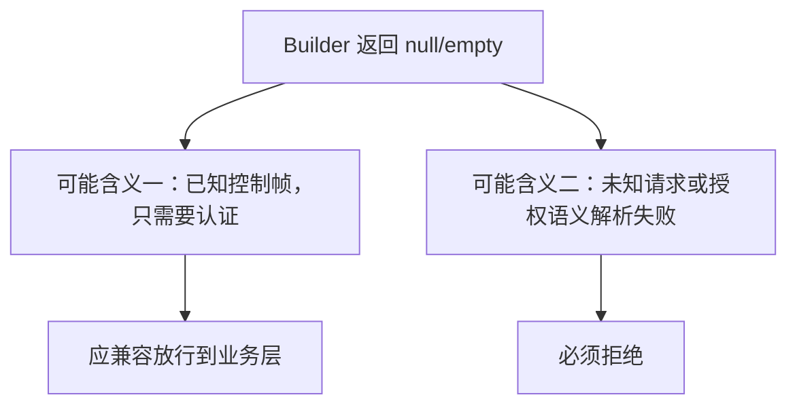

此外，授权 Builder 和业务处理使用的 ClientType 来源不一致：Builder 读取客户端在本次
Heartbeat 中声明的 `request.client_type`，`ClientActivity` 则读取服务端会话中已经保存
的 `Settings.clientType`。客户端声明不是可信的授权依据。

代表性代码：

```java
if (message instanceof HeartbeatRequest) {
    HeartbeatRequest request = (HeartbeatRequest) message;
    if (!isConsumerClientType(request.getClientType())) {
        return null; // Producer Heartbeat
    }
}
if (message instanceof TelemetryCommand) {
    result = newContext(metadata, (TelemetryCommand) message);
    // 非 SETTINGS 的 TelemetryCommand 返回 null
}
```

Producer 的 Topic 实际保存在此前的 Settings 中，不能在本次帧上虚构 Producer Group：

```java
Settings settings = grpcClientSettingsManager.getClientSettings(ctx);
for (Resource topic : settings.getPublishing().getTopicsList()) {
    registerProducer(ctx, topic.getName());
}
```

如果只按请求的 `client_type=PRODUCER` 标记为 `AUTHENTICATED_ONLY`，会产生新的绕过：

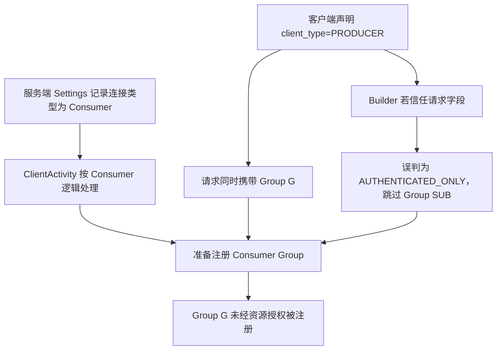

S-06 的“空 context 默认拒绝”能够阻断这条路径；但不能为了让 Producer Heartbeat 通过，
又直接相信请求中的 ClientType。

关键位置：

- `auth/src/main/java/org/apache/rocketmq/auth/authorization/builder/DefaultAuthorizationContextBuilder.java:122`
- `auth/src/main/java/org/apache/rocketmq/auth/authorization/builder/DefaultAuthorizationContextBuilder.java:549`
- `proxy/src/main/java/org/apache/rocketmq/proxy/grpc/v2/client/ClientActivity.java:94`

#### 可选方案

| 方案 | 优点 | 缺点 |
| --- | --- | --- |
| A. 所有空上下文都放行 | 兼容简单 | 恢复 fail-open，未知请求也可能绕过 |
| B. 用 descriptor 白名单允许空上下文 | 改动较小 | 配置容易漂移，仍未表达协议语义 |
| C. 显式区分三态，并以可信会话状态解析 | 安全和兼容语义清晰 | 需要调整 Builder/Evaluator 接口，并读取服务端 session state |

三态模型为：

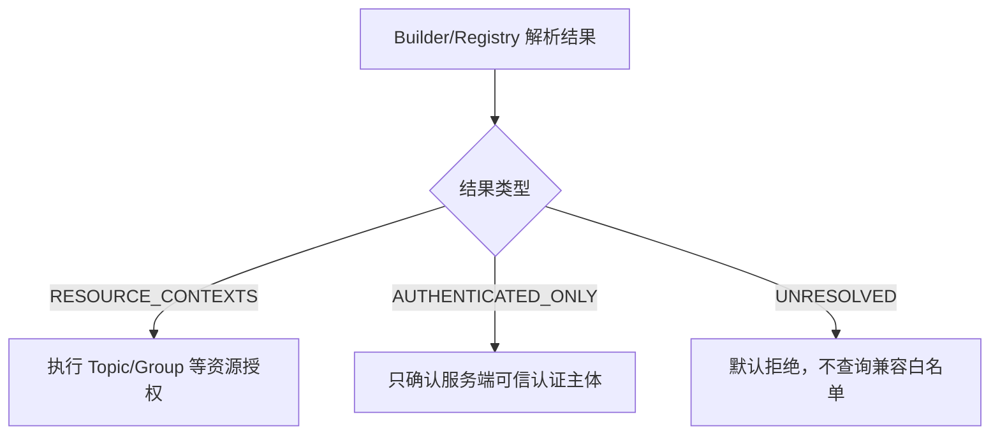

#### 最终建议

选择方案 C。方案 B 只能作为短期兼容措施，而且白名单必须是明确 descriptor 列表、默认
为空；绝不能恢复“空上下文统一放行”。三态分类还必须满足：

1. 不能仅根据请求中的 `client_type` 判定 `AUTHENTICATED_ONLY`；
2. Heartbeat/Termination 只要携带非空 Group，就必须生成 Group `SUB` context，不受请求
   ClientType 影响；
3. 对依赖会话状态的 Producer 控制帧，只有服务端已经保存并验证对应 Settings 时，才能
   判定为 `AUTHENTICATED_ONLY`；请求 ClientType 与 Settings 不一致时直接拒绝；
4. Settings 为空、资源为空、session 不存在或解析失败都属于 `UNRESOLVED`，不能降级为
   `AUTHENTICATED_ONLY`。

#### 验证方式

对 Producer/Consumer Heartbeat、Termination、Settings 和其他 Telemetry 做对称测试；
未认证的控制帧和未知 descriptor 必须继续被拒绝。必须增加请求 ClientType 与服务端
Settings 不一致、伪造 Producer 但携带 Group、session 不存在和空 Settings 的负向测试。

---

### R-08：老客户端 Topic 为空时无法授权，兼容白名单又会绕过 Topic 权限边界

- **结论**：客户端兼容和显式风险接受问题。
- **状态**：待确定兼容策略，并补充老客户端行为证据。

#### 问题与影响

以下请求的 Topic 为空时无法构造资源授权上下文，严格模式会拒绝：

- `VIEW_MESSAGE_BY_ID`（33）
- `END_TRANSACTION`（37）
- `RESUME_CHECK_HALF_MESSAGE`（323）

Header 中 Topic 有资源注解但没有 `@CFNotNull`：

```java
@RocketMQResource(ResourceType.TOPIC)
private String topic;
```

这只能证明服务端协议允许字段为空，不能单独证明哪些历史客户端确实不传；还需用旧版本
客户端代码或真实流量补证。

#### 出现原因

协议兼容性允许 Topic 为空，而 ACL 2.0 需要明确资源才能授权。服务端无法仅凭
RequestCode 判断该用户是否有权访问 Offset 指向的真实 Topic。

#### 可选方案

| 方案 | 优点 | 缺点 |
| --- | --- | --- |
| A. 默认拒绝并推动客户端升级 | 安全边界最清楚 | 可能影响确实不传 Topic 的旧客户端 |
| B. 独立的空上下文 RequestCode 白名单 | 可按部署临时兼容 | 白名单请求在 Topic 为空时没有资源权限边界 |
| C. Processor 读出消息后推导 Topic 并重新授权 | 资源准确 | 需要把 ACL 调用侵入业务流程，改动较大 |

严格入口应只在 context 真正为空时查询独立白名单：

```java
if (CollectionUtils.isEmpty(contexts)) {
    if (!authConfig.isAuthorizationRequired(rpcCode)
        || authConfig.isAuthorizationEmptyContextAllowed(rpcCode)) {
        return;
    }
    throw new AuthorizationException(
        "Authorization context is empty for request code {}.", rpcCode);
}
evaluate(contexts);
```

关键位置：

- `remoting/src/main/java/org/apache/rocketmq/remoting/protocol/header/ViewMessageRequestHeader.java:32`
- `remoting/src/main/java/org/apache/rocketmq/remoting/protocol/header/EndTransactionRequestHeader.java:32`
- `remoting/src/main/java/org/apache/rocketmq/remoting/protocol/header/ResumeCheckHalfMessageRequestHeader.java:29`
- `auth/src/main/java/org/apache/rocketmq/auth/authorization/AuthorizationEvaluator.java:42`

实现严格入口时不能只按 `rpcCode` 字符串查询白名单，必须先判断该 code 是否具有已知授权
语义，确保未知 RequestCode 在任何白名单误配置下都始终拒绝。

方案 B 也不是无损兼容：Topic 为空时，这三个 Header 都无法生成其他资源 context。一旦某个
RequestCode 被加入空上下文白名单，任意通过认证的普通用户都可能跳过 Topic 权限边界。
对 `VIEW_MESSAGE_BY_ID` 而言，这相当于只按 Offset 读取，无法证明调用者有权访问 Offset
指向的 Topic。

#### 最终建议

默认采用方案 A。确有迁移需求时才启用方案 B：

- `authorizationEmptyContextWhitelist` 默认值为空；
- 只配置已确认的 RequestCode，并设置告警和退出期限；
- 请求实际携带 Topic 时必须走正常 ACL，不能因为 RequestCode 在白名单中而跳过；
- 严格授权入口必须接收 Builder/Registry 产生的三态解析结果，并在查询任何白名单前拒绝
  `UNRESOLVED`；Evaluator 不再维护另一套 RequestCode 语义表；
- 该白名单是全局风险接受，只适用于所有认证主体均可信的受控部署，不能作为互联网或多租户
  环境的默认兼容方案。

不建议采用方案 C，以免把 ACL 逻辑大范围侵入原业务流程。

#### 验证方式

三个 RequestCode 分别覆盖 Topic 有/无、白名单开/关；再用有权限和无权限用户验证“传了
Topic 就正常授权”。未知 RequestCode 还必须覆盖普通白名单、空上下文白名单及两者同时
配置，全部都应拒绝。

---

## 四、结论与行动项

### 4.1 本次修复范围和闭环条件

| 问题 | 本次修复内容 | 闭环条件 |
| --- | --- | --- |
| E-01 Proxy Registry 未初始化 | 在 Proxy Remoting Processor 注册完成后初始化 `RequestHeaderRegistry` | 7 个扩展接口均能生成正确 context；可执行业务接口完成低权限拒绝和正确权限允许验证 |
| E-02 Broker Admin 接口无授权上下文 | 按请求入参补齐 Cluster 或 Group Resource/Action | 5 个外部反馈接口不再产生空 context；单个和批量 Group 按逐 Group `CREATE` 授权 |
| E-03 gRPC 来源 IP 可伪造 | 删除客户端同名 Metadata，并由服务端连接属性强制写入 | 客户端预置地址不能影响 AuthorizationContext；真实进程配合 IP ACL 的负向验证通过 |

### 4.2 后续迭代需要组内确认的技术决策

本节决策不进入本次外部漏洞修复。

| 议题 | 可选方向 | 最终建议 |
| --- | --- | --- |
| gRPC 防重放范围 | 仅时间窗口；绑定 RPC/Body；版本化签名+nonce | 版本化签名、body digest、时间窗口和 nonce；Streaming 单独设计 |
| PROXY protocol 信任边界 | 只依赖网络；可信 CIDR；独立 mTLS 端口 | 网络隔离立即执行，代码补可信 CIDR 校验 |
| NameServer/Controller | 后续接入；单独专项；只写部署边界 | 先明确网络隔离，完整 ACL 另立专项 |
| gRPC 合法无资源帧 | 广泛放行；descriptor 白名单；三态模型 | 三态模型；依赖服务端会话状态，descriptor 白名单只做临时兼容 |
| 老客户端空 Topic | 默认拒绝；临时白名单；业务层重新授权 | 默认拒绝，确有证据时临时白名单并设退出期限 |
| Stateful 吊销时效 | 接受 TTL；主动失效；版本化缓存 | 先定 SLA；要求立即吊销时采用主动失效 |

### 4.3 验收方式

本次只验收 E-01、E-02、E-03，不以模块测试数量代替安全结论：

1. **E-01**：验证 7 个 RequestCode 的 context；对可实际处理的接口完成低权限拒绝和正确
   权限允许；对业务分派不完整的接口只确认授权上下文，不夸大业务影响。
2. **E-02**：验证 5 个外部反馈接口均生成预期 Resource/Action；复现普通用户修改 Broker
   配置的 PoC 并确认修复后拒绝；验证 Group 单个和批量请求逐资源授权。
3. **E-03**：验证正常请求使用服务端真实 remote address；客户端预置
   `rpc-remote-address` 时必须被覆盖；完成真实 gRPC 进程配合 IP ACL 的负向测试。
4. **回归边界**：确认修复只改变 ACL 上下文和可信 Metadata，不修改业务 Processor 的正常
   请求流程。

S-01～S-20 和 R-01～R-08 的测试矩阵随对应后续迭代执行，不作为本次发布门禁。

### 4.4 最终建议

- 本次代码、测试和发布只处理 E-01、E-02、E-03。
- 三项漏洞必须分别完成 Registry 初始化、Admin Resource/Action 补齐和服务端可信来源地址
  覆盖，不能用网络边界或统一粗粒度权限代替代码修复。
- S-01～S-20 和 R-01～R-08 不混入本次补丁；后续按独立变更评审，避免扩大回归面。
