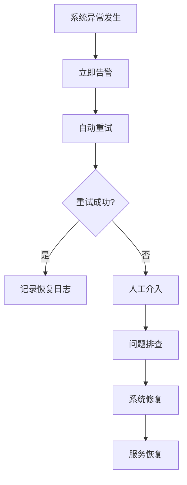
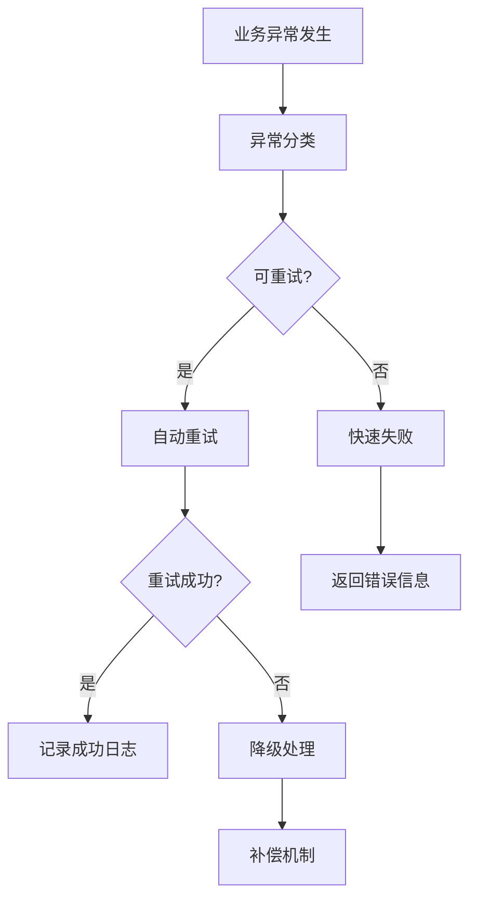

# RocketMQ异常体系全面分析文档

## 目录
- [1. 概述](#1-概述)
- [2. 异常分类体系](#2-异常分类体系)
- [3. 客户端异常详解](#3-客户端异常详解)
- [4. 服务端异常详解](#4-服务端异常详解)
- [5. 业务异常 vs 系统异常](#5-业务异常-vs-系统异常)
- [6. 异常处理最佳实践](#6-异常处理最佳实践)
- [7. 监控告警建议](#7-监控告警建议)

---

## 1. 概述

RocketMQ作为分布式消息中间件，具有完善的异常体系来处理各种错误场景。本文档全面分析RocketMQ中所有可能出现的异常，并从多个维度进行分类，帮助开发者和运维人员更好地理解、处理和监控这些异常。

### 1.1 异常体系特点
- **层次化设计**：从网络层到业务层的多层异常体系
- **明确分工**：客户端异常与服务端异常职责清晰
- **响应码体系**：统一的错误码标准，便于问题定位
- **可扩展性**：支持自定义异常和错误码

---

## 2. 异常分类体系

### 2.1 按异常来源分类

```
RocketMQ异常体系
├── 客户端异常 (Client-Side Exceptions)
│   ├── MQClientException - 客户端核心异常
│   ├── RequestTimeoutException - 请求超时异常
│   ├── OffsetNotFoundException - 偏移量未找到异常
│   └── ClientErrorCode - 客户端错误码
├── 服务端异常 (Server-Side Exceptions)
│   ├── MQBrokerException - Broker异常
│   ├── ResponseCode - 服务端响应码
│   ├── AbortProcessException - 中断处理异常
│   └── 各模块专用异常
├── 网络通信异常 (Remoting Exceptions)
│   ├── RemotingException - 远程通信基础异常
│   ├── RemotingConnectException - 连接异常
│   ├── RemotingTimeoutException - 超时异常
│   └── 其他通信异常
└── 存储异常 (Store Exceptions)
    ├── StoreException - 存储基础异常
    ├── ConsumeQueueException - 消费队列异常
    └── TieredStoreException - 分层存储异常
```

### 2.2 按业务属性分类

```
异常业务属性分类
├── 业务异常 (Business Exceptions)
│   ├── Topic/Queue管理异常
│   ├── 消息处理异常
│   ├── 权限认证异常
│   ├── 参数配置异常
│   └── 事务处理异常
└── 系统异常 (System Exceptions)
    ├── 系统基础异常
    ├── 存储系统异常
    ├── 网络通信异常
    ├── 服务可用性异常
    └── 流控保护异常
```

---

## 3. 客户端异常详解

### 3.1 MQClientException - 客户端核心异常

**文件位置**: `client/src/main/java/org/apache/rocketmq/client/exception/MQClientException.java`

**异常特征**:
- 继承自 `Exception`
- 包含响应码 (`responseCode`) 和错误信息 (`errorMessage`)
- 所有客户端异常的基础类

**构造方法**:
```java
// 基础构造方法
MQClientException(String errorMessage, Throwable cause)
MQClientException(int responseCode, String errorMessage)
MQClientException(int responseCode, String errorMessage, Throwable cause)
```

**常见场景**:
- 客户端配置错误
- 参数验证失败
- 客户端状态异常
- Producer/Consumer启动失败

### 3.2 ClientErrorCode - 客户端错误码

**文件位置**: `client/src/main/java/org/apache/rocketmq/client/common/ClientErrorCode.java`

| 错误码 | 常量名 | 描述 | 处理建议 |
|--------|--------|------|----------|
| 10001 | CONNECT_BROKER_EXCEPTION | 连接Broker异常 | 检查网络连接和Broker地址 |
| 10002 | ACCESS_BROKER_TIMEOUT | 访问Broker超时 | 检查网络延迟和Broker负载 |
| 10003 | BROKER_NOT_EXIST_EXCEPTION | Broker不存在异常 | 检查Broker是否正常运行 |
| 10004 | NO_NAME_SERVER_EXCEPTION | NameServer不存在异常 | 检查NameServer配置和状态 |
| 10005 | NOT_FOUND_TOPIC_EXCEPTION | Topic不存在异常 | 先创建Topic或检查Topic名称 |
| 10006 | REQUEST_TIMEOUT_EXCEPTION | 请求超时异常 | 调整超时时间或检查系统性能 |
| 10007 | CREATE_REPLY_MESSAGE_EXCEPTION | 创建回复消息异常 | 检查RPC消息格式 |

### 3.3 RequestTimeoutException - 请求超时异常

**文件位置**: `client/src/main/java/org/apache/rocketmq/client/exception/RequestTimeoutException.java`

**使用场景**:
- RPC请求超时
- 同步发送消息超时
- 同步消费消息超时

### 3.4 OffsetNotFoundException - 偏移量未找到异常

**文件位置**: `client/src/main/java/org/apache/rocketmq/client/exception/OffsetNotFoundException.java`

**继承关系**: `OffsetNotFoundException extends MQBrokerException`

**使用场景**:
- 消费偏移量不存在
- 偏移量重置失败

---

## 4. 服务端异常详解

### 4.1 响应码体系

#### 4.1.1 RemotingSysResponseCode - 系统基础响应码

**文件位置**: `remoting/src/main/java/org/apache/rocketmq/remoting/protocol/RemotingSysResponseCode.java`

| 响应码 | 常量名 | 描述 | 异常类型 |
|--------|--------|------|----------|
| 0 | SUCCESS | 成功 | 正常 |
| 1 | SYSTEM_ERROR | 系统错误 | 系统异常 |
| 2 | SYSTEM_BUSY | 系统繁忙 | 系统异常 |
| 3 | REQUEST_CODE_NOT_SUPPORTED | 请求码不支持 | 系统异常 |
| 4 | TRANSACTION_FAILED | 事务失败 | 系统异常 |

#### 4.1.2 ResponseCode - 业务响应码

**文件位置**: `remoting/src/main/java/org/apache/rocketmq/remoting/protocol/ResponseCode.java`

**存储相关异常**:
| 响应码 | 常量名 | 描述 | 异常类型 |
|--------|--------|------|----------|
| 10 | FLUSH_DISK_TIMEOUT | 刷盘超时 | 系统异常 |
| 11 | SLAVE_NOT_AVAILABLE | 从节点不可用 | 系统异常 |
| 12 | FLUSH_SLAVE_TIMEOUT | 刷从节点超时 | 系统异常 |

**业务逻辑异常**:
| 响应码 | 常量名 | 描述 | 异常类型 |
|--------|--------|------|----------|
| 13 | MESSAGE_ILLEGAL | 消息非法 | 业务异常 |
| 14 | SERVICE_NOT_AVAILABLE | 服务不可用 | 系统异常 |
| 15 | VERSION_NOT_SUPPORTED | 版本不支持 | 业务异常 |
| 16 | NO_PERMISSION | 无权限 | 业务异常 |
| 17 | TOPIC_NOT_EXIST | Topic不存在 | 业务异常 |
| 18 | TOPIC_EXIST_ALREADY | Topic已存在 | 业务异常 |
| 19 | PULL_NOT_FOUND | 拉取未找到 | 业务异常 |
| 20 | PULL_RETRY_IMMEDIATELY | 立即重试拉取 | 业务异常 |
| 21 | PULL_OFFSET_MOVED | 拉取偏移量移动 | 业务异常 |
| 22 | QUERY_NOT_FOUND | 查询未找到 | 业务异常 |

**订阅相关异常**:
| 响应码 | 常量名 | 描述 | 异常类型 |
|--------|--------|------|----------|
| 23 | SUBSCRIPTION_PARSE_FAILED | 订阅解析失败 | 业务异常 |
| 24 | SUBSCRIPTION_NOT_EXIST | 订阅不存在 | 业务异常 |
| 25 | SUBSCRIPTION_NOT_LATEST | 订阅不是最新 | 业务异常 |
| 26 | SUBSCRIPTION_GROUP_NOT_EXIST | 订阅组不存在 | 业务异常 |

**过滤相关异常**:
| 响应码 | 常量名 | 描述 | 异常类型 |
|--------|--------|------|----------|
| 27 | FILTER_DATA_NOT_EXIST | 过滤数据不存在 | 业务异常 |
| 28 | FILTER_DATA_NOT_LATEST | 过滤数据不是最新 | 业务异常 |
| 29 | INVALID_PARAMETER | 无效参数 | 业务异常 |

**事务相关异常**:
| 响应码 | 常量名 | 描述 | 异常类型 |
|--------|--------|------|----------|
| 200 | TRANSACTION_SHOULD_COMMIT | 事务应该提交 | 业务异常 |
| 201 | TRANSACTION_SHOULD_ROLLBACK | 事务应该回滚 | 业务异常 |
| 202 | TRANSACTION_STATE_UNKNOW | 事务状态未知 | 业务异常 |
| 203 | TRANSACTION_STATE_GROUP_WRONG | 事务状态组错误 | 业务异常 |

**系统状态异常**:
| 响应码 | 常量名 | 描述 | 异常类型 |
|--------|--------|------|----------|
| 206 | CONSUMER_NOT_ONLINE | 消费者不在线 | 系统异常 |
| 207 | CONSUME_MSG_TIMEOUT | 消费消息超时 | 系统异常 |
| 208 | NO_MESSAGE | 没有消息 | 业务异常 |
| 209 | POLLING_FULL | 轮询满 | 系统异常 |
| 210 | POLLING_TIMEOUT | 轮询超时 | 系统异常 |
| 211 | BROKER_NOT_EXIST | Broker不存在 | 系统异常 |
| 212 | BROKER_DISPATCH_NOT_COMPLETE | Broker分发未完成 | 系统异常 |
| 215 | FLOW_CONTROL | 流量控制 | 系统异常 |

**Controller相关异常** (2000-2016):
| 响应码 | 常量名 | 描述 | 异常类型 |
|--------|--------|------|----------|
| 2000 | CONTROLLER_FENCED_MASTER_EPOCH | Controller主节点epoch被隔离 | 系统异常 |
| 2001 | CONTROLLER_FENCED_SYNC_STATE_SET_EPOCH | 同步状态集epoch被隔离 | 系统异常 |
| 2007 | CONTROLLER_NOT_LEADER | Controller不是Leader | 系统异常 |
| 2015 | CONTROLLER_JRAFT_INTERNAL_ERROR | JRaft内部错误 | 系统异常 |

### 4.2 MQBrokerException - Broker异常

**文件位置**: `client/src/main/java/org/apache/rocketmq/client/exception/MQBrokerException.java`

**异常特征**:
- 表示Broker端处理请求时发生的异常
- 包含响应码、错误信息和Broker地址
- 虽然在client包中，但表示服务端错误

**属性**:
```java
private final int responseCode;      // 响应码
private final String errorMessage;  // 错误信息
private final String brokerAddr;    // Broker地址
```

### 4.3 存储异常

#### 4.3.1 StoreException - 存储基础异常

**文件位置**: `store/src/main/java/org/apache/rocketmq/store/exception/StoreException.java`

**使用场景**:
- 磁盘IO异常
- 存储文件损坏
- 存储空间不足

#### 4.3.2 ConsumeQueueException - 消费队列异常

**文件位置**: `store/src/main/java/org/apache/rocketmq/store/exception/ConsumeQueueException.java`

**继承关系**: `ConsumeQueueException extends StoreException`

**使用场景**:
- 消费队列文件损坏
- 消费队列索引异常

#### 4.3.3 TieredStoreException - 分层存储异常

**文件位置**: `tieredstore/src/main/java/org/apache/rocketmq/tieredstore/exception/TieredStoreException.java`

**错误码**: 使用`TieredStoreErrorCode`枚举定义各种存储错误

### 4.4 网络通信异常

#### 4.4.1 RemotingException - 远程通信基础异常

**文件位置**: `remoting/src/main/java/org/apache/rocketmq/remoting/exception/RemotingException.java`

**子类异常**:
- `RemotingConnectException` - 连接异常
- `RemotingTimeoutException` - 超时异常
- `RemotingSendRequestException` - 发送请求异常
- `RemotingTooMuchRequestException` - 请求过多异常
- `RemotingCommandException` - 命令异常

#### 4.4.2 RpcException - RPC异常

**文件位置**: `remoting/src/main/java/org/apache/rocketmq/remoting/rpc/RpcException.java`

**继承关系**: `RpcException extends RemotingException`

### 4.5 认证授权异常

#### 4.5.1 AuthenticationException - 认证异常

**文件位置**: `auth/src/main/java/org/apache/rocketmq/auth/authentication/exception/AuthenticationException.java`

**使用场景**:
- 用户名密码错误
- 认证token过期
- 认证配置错误

#### 4.5.2 AuthorizationException - 授权异常

**文件位置**: `auth/src/main/java/org/apache/rocketmq/auth/authorization/exception/AuthorizationException.java`

**使用场景**:
- 权限不足
- ACL配置错误
- 资源访问被拒绝

### 4.6 其他专用异常

#### 4.6.1 AbortProcessException - 中断处理异常

**文件位置**: `common/src/main/java/org/apache/rocketmq/common/AbortProcessException.java`

**使用场景**:
- Broker钩子函数中断处理
- 需要立即返回错误响应的场景

#### 4.6.2 MQFilterException - 消息过滤异常

**文件位置**: `filter/src/main/java/org/apache/rocketmq/filter/expression/MQFilterException.java`

**使用场景**:
- 消息过滤表达式错误
- 过滤器执行异常

---

## 5. 业务异常 vs 系统异常

### 5.1 业务异常 (Business Exceptions)

**定义**: 由业务逻辑、配置错误、用户操作不当等引起的异常，通常可以通过调整业务逻辑、配置或重试来解决。

#### 5.1.1 Topic/Queue相关业务异常
```java
TOPIC_NOT_EXIST = 17                    // Topic不存在 - 需要先创建Topic
TOPIC_EXIST_ALREADY = 18               // Topic已存在 - 重复创建
SUBSCRIPTION_GROUP_NOT_EXIST = 26      // 消费组不存在 - 需要先创建消费组
SUBSCRIPTION_NOT_EXIST = 24            // 订阅不存在 - 需要先订阅
SUBSCRIPTION_NOT_LATEST = 25           // 订阅不是最新 - 需要更新订阅
SUBSCRIPTION_PARSE_FAILED = 23         // 订阅解析失败 - 订阅表达式错误
```

#### 5.1.2 消息相关业务异常
```java
MESSAGE_ILLEGAL = 13                   // 消息非法 - 消息格式/内容不符合要求
PULL_NOT_FOUND = 19                   // 拉取消息未找到 - 正常业务场景
QUERY_NOT_FOUND = 22                  // 查询消息未找到 - 正常业务场景
NO_MESSAGE = 208                      // 没有消息 - 正常业务场景
PULL_OFFSET_MOVED = 21                // 消费偏移量被移动 - 需要重置偏移量
```

#### 5.1.3 权限相关业务异常
```java
NO_PERMISSION = 16                    // 无权限 - ACL配置问题
AuthenticationException               // 身份认证失败 - 用户名密码错误
AuthorizationException               // 权限验证失败 - 权限配置问题
```

#### 5.1.4 参数配置业务异常
```java
INVALID_PARAMETER = 29               // 无效参数 - 参数配置错误
VERSION_NOT_SUPPORTED = 15           // 版本不支持 - 客户端版本过低
```

#### 5.1.5 事务相关业务异常
```java
TRANSACTION_SHOULD_COMMIT = 200      // 事务应该提交 - 业务逻辑决定
TRANSACTION_SHOULD_ROLLBACK = 201    // 事务应该回滚 - 业务逻辑决定
TRANSACTION_STATE_UNKNOW = 202       // 事务状态未知 - 需要业务方确认
TRANSACTION_STATE_GROUP_WRONG = 203  // 事务状态组错误 - 配置问题
```

### 5.2 系统异常 (System Exceptions)

**定义**: 由系统资源不足、网络问题、硬件故障、系统配置等引起的异常，通常需要系统管理员介入处理。

#### 5.2.1 系统基础异常
```java
SYSTEM_ERROR = 1                     // 系统错误 - 未知系统异常
SYSTEM_BUSY = 2                      // 系统繁忙 - 资源不足，需要限流
REQUEST_CODE_NOT_SUPPORTED = 3      // 请求码不支持 - 系统版本不匹配
TRANSACTION_FAILED = 4               // 事务失败 - 系统层面事务处理失败
```

#### 5.2.2 存储系统异常
```java
FLUSH_DISK_TIMEOUT = 10              // 刷盘超时 - 磁盘IO性能问题
SLAVE_NOT_AVAILABLE = 11             // 从节点不可用 - 主从同步问题
FLUSH_SLAVE_TIMEOUT = 12             // 刷从节点超时 - 网络或从节点问题
```

#### 5.2.3 服务可用性系统异常
```java
SERVICE_NOT_AVAILABLE = 14           // 服务不可用 - 服务宕机或维护
BROKER_NOT_EXIST = 211              // Broker不存在 - Broker宕机
CONSUMER_NOT_ONLINE = 206           // 消费者不在线 - 消费者进程异常
BROKER_DISPATCH_NOT_COMPLETE = 212   // Broker分发未完成 - 系统处理延迟
```

#### 5.2.4 网络通信系统异常
```java
CONNECT_BROKER_EXCEPTION = 10001     // 连接Broker异常 - 网络连接问题
ACCESS_BROKER_TIMEOUT = 10002        // 访问Broker超时 - 网络延迟或Broker繁忙
BROKER_NOT_EXIST_EXCEPTION = 10003   // Broker不存在异常 - Broker宕机
NO_NAME_SERVER_EXCEPTION = 10004     // NameServer不存在异常 - NameServer宕机
REQUEST_TIMEOUT_EXCEPTION = 10006    // 请求超时异常 - 网络或系统性能问题
```

#### 5.2.5 流控系统异常
```java
FLOW_CONTROL = 215                  // 流量控制 - 系统保护机制
POLLING_FULL = 209                  // 轮询满 - 系统资源不足
POLLING_TIMEOUT = 210               // 轮询超时 - 系统处理能力不足
CONSUME_MSG_TIMEOUT = 207           // 消费消息超时 - 消费者处理能力不足
```

---

## 6. 异常处理最佳实践

### 6.1 业务异常处理策略

#### 6.1.1 可重试异常
```java
// 示例：处理Topic不存在异常
try {
    producer.send(message);
} catch (MQClientException e) {
    if (e.getResponseCode() == ResponseCode.TOPIC_NOT_EXIST) {
        // 自动创建Topic或提示用户创建
        createTopicIfNotExists(topicName);
        // 重试发送
        producer.send(message);
    }
}
```

#### 6.1.2 快速失败异常
```java
// 示例：处理权限异常
try {
    producer.send(message);
} catch (MQClientException e) {
    if (e.getResponseCode() == ResponseCode.NO_PERMISSION) {
        // 权限异常，快速失败，不重试
        throw new BusinessException("无权限发送消息到Topic: " + topicName);
    }
}
```

#### 6.1.3 业务降级处理
```java
// 示例：消息发送失败时的降级处理
try {
    producer.send(message);
} catch (MQClientException e) {
    // 记录到本地文件或数据库，后续补偿
    saveToLocalStorage(message);
    log.warn("消息发送失败，已保存到本地待补偿, error: {}", e.getMessage());
}
```

### 6.2 系统异常处理策略

#### 6.2.1 自动重试机制
```java
// 示例：网络异常重试
@Retryable(value = {RemotingException.class}, maxAttempts = 3, backoff = @Backoff(delay = 1000))
public void sendMessage(Message message) throws Exception {
    try {
        producer.send(message);
    } catch (RemotingTimeoutException e) {
        log.warn("网络超时，准备重试: {}", e.getMessage());
        throw e; // 触发重试
    }
}
```

#### 6.2.2 熔断机制
```java
// 示例：系统繁忙时的熔断处理
@CircuitBreaker(name = "rocketmq-producer", fallbackMethod = "fallbackSend")
public void sendMessage(Message message) throws Exception {
    try {
        producer.send(message);
    } catch (MQClientException e) {
        if (e.getResponseCode() == ResponseCode.SYSTEM_BUSY) {
            throw new SystemBusyException("系统繁忙");
        }
        throw e;
    }
}

public void fallbackSend(Message message, Exception ex) {
    // 熔断后的降级处理
    saveToLocalQueue(message);
}
```

#### 6.2.3 监控告警
```java
// 示例：系统异常监控
try {
    producer.send(message);
} catch (MQClientException e) {
    if (isSystemException(e.getResponseCode())) {
        // 发送告警
        alertService.sendAlert("RocketMQ系统异常", e.getMessage());
        // 记录监控指标
        meterRegistry.counter("rocketmq.system.error", "code", String.valueOf(e.getResponseCode())).increment();
    }
    throw e;
}
```

### 6.3 异常日志记录

#### 6.3.1 结构化日志
```java
// 推荐的异常日志格式
log.error("RocketMQ操作失败 - 操作类型: {}, Topic: {}, 错误码: {}, 错误信息: {}, Broker地址: {}", 
    operation, topic, responseCode, errorMessage, brokerAddr, exception);
```

#### 6.3.2 日志级别建议
- **ERROR**: 系统异常、严重的业务异常
- **WARN**: 一般业务异常、可恢复的异常
- **INFO**: 正常的业务异常（如消息未找到）
- **DEBUG**: 详细的异常堆栈信息

---

## 7. 监控告警建议

### 7.1 关键指标监控

#### 7.1.1 异常率监控
```yaml
# Prometheus监控指标示例
rocketmq_client_exception_total{type="MQClientException", code="10001"}
rocketmq_broker_exception_total{type="MQBrokerException", code="1"}
rocketmq_system_exception_rate{service="producer"}
```

#### 7.1.2 响应码分布
```yaml
# 按响应码统计异常分布
rocketmq_response_code_total{code="0"}     # 成功
rocketmq_response_code_total{code="1"}     # 系统错误
rocketmq_response_code_total{code="2"}     # 系统繁忙
rocketmq_response_code_total{code="17"}    # Topic不存在
```

### 7.2 告警规则配置

#### 7.2.1 系统异常告警
```yaml
# 系统异常率告警
- alert: RocketMQSystemExceptionHigh
  expr: rate(rocketmq_system_exception_total[5m]) > 0.01
  for: 1m
  labels:
    severity: critical
  annotations:
    summary: "RocketMQ系统异常率过高"
    description: "系统异常率: {{ $value }}"
```

#### 7.2.2 业务异常告警
```yaml
# 业务异常率告警
- alert: RocketMQBusinessExceptionHigh
  expr: rate(rocketmq_business_exception_total[5m]) > 0.1
  for: 5m
  labels:
    severity: warning
  annotations:
    summary: "RocketMQ业务异常率过高"
    description: "业务异常率: {{ $value }}"
```

### 7.3 异常处理流程

#### 7.3.1 系统异常处理流程


#### 7.3.2 业务异常处理流程


### 7.4 性能影响评估

#### 7.4.1 异常对性能的影响
- **网络异常**: 可能导致连接池耗尽，影响整体吞吐量
- **存储异常**: 可能导致消息堆积，影响消费性能
- **系统繁忙**: 触发流控机制，降低系统处理能力

#### 7.4.2 优化建议
1. **连接池管理**: 合理配置连接池大小，避免连接耗尽
2. **超时设置**: 根据业务需求合理设置超时时间
3. **重试策略**: 使用指数退避算法，避免重试风暴
4. **熔断机制**: 在系统异常时快速熔断，保护系统稳定性

---

## 8. 总结

RocketMQ的异常体系设计完善，层次清晰，为分布式消息系统的稳定运行提供了强有力的保障。通过合理的异常分类和处理策略，可以：

1. **提高系统可靠性**: 通过异常处理机制确保系统在各种异常情况下的稳定运行
2. **加快问题定位**: 清晰的异常分类和错误码有助于快速定位问题根因
3. **优化运维效率**: 区分业务异常和系统异常，合理分配运维资源
4. **提升用户体验**: 通过适当的异常处理和降级机制，减少异常对用户的影响

在实际使用中，建议：
- 根据业务场景制定合适的异常处理策略
- 建立完善的监控告警体系
- 定期分析异常数据，持续优化系统稳定性
- 做好异常处理的文档和培训工作

---

**文档版本**: v1.0  
**最后更新**: 2025-11-10  
**适用版本**: RocketMQ 5.x