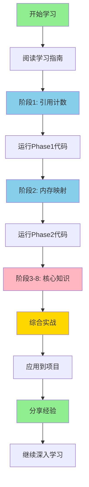

# 🚀 RocketMQ Store 学习快速导航

> 一站式学习资料索引，帮你快速找到需要的内容

---

## 📂 文件结构总览

```
rocketmq-dsx/
│
├── 📖 README-学习指南.md                      ⭐ 从这里开始！
├── 🎓 学习完成总结.md                          ⭐ 学习成果总结
│
├── 📚 学习笔记/
│   ├── 阶段1-ReferenceResource详解.md         ⭐ 完整详解 (10,000字)
│   ├── 阶段2-MappedFile与零拷贝详解.md        ⭐ 完整详解 (12,000字)
│   └── 阶段3-8精华汇总.md                      ⭐ 核心知识点 (8,000字)
│
└── 💻 学习实践代码/
    ├── phase1/                                 ⭐ 可运行代码
    │   ├── ReferenceResource.java
    │   ├── ManagedFile.java
    │   ├── ManagedFileTest.java
    │   └── PerformanceTest.java
    │
    └── phase2/                                 ⭐ 可运行代码
        ├── SimpleBufferPool.java
        └── IOPerformanceComparison.java
```

---

## 🎯 我应该从哪里开始？

### 场景1：我是第一次学习
```
1️⃣ 阅读: README-学习指南.md （了解学习路径）
2️⃣ 学习: 学习笔记/阶段1-ReferenceResource详解.md
3️⃣ 实践: 运行 学习实践代码/phase1/ 中的代码
4️⃣ 继续: 按顺序学习阶段2-8
```

### 场景2：我想快速了解核心知识
```
1️⃣ 阅读: 学习完成总结.md （快速概览）
2️⃣ 阅读: 学习笔记/阶段3-8精华汇总.md （核心要点）
3️⃣ 深入: 选择感兴趣的阶段详细学习
```

### 场景3：我想运行代码看效果
```
1️⃣ 进入: 学习实践代码/phase1/
2️⃣ 运行: java ManagedFileTest
3️⃣ 运行: java PerformanceTest
4️⃣ 进入: 学习实践代码/phase2/
5️⃣ 运行: java IOPerformanceComparison
```

### 场景4：我想查找特定主题
```
📍 引用计数管理        → 阶段1详解
📍 mmap与零拷贝        → 阶段2详解
📍 文件预分配          → 阶段3-8汇总 - 阶段3章节
📍 并发控制优化        → 阶段3-8汇总 - 阶段4章节
📍 CommitLog架构       → 阶段3-8汇总 - 阶段5章节
📍 刷盘与HA           → 阶段3-8汇总 - 阶段6章节
📍 性能监控           → 阶段3-8汇总 - 阶段7章节
📍 综合实战           → 阶段3-8汇总 - 阶段8章节
```

---

## 📖 学习笔记内容速查

### 阶段1：ReferenceResource详解 (10,000字)

**核心内容：**
- ✅ 引用计数原理
- ✅ AtomicLong vs synchronized 性能对比
- ✅ 状态机图解
- ✅ hold/release/shutdown 方法详解
- ✅ ManagedFile 完整实现
- ✅ 4个测试场景
- ✅ 性能对比实验

**适合谁看：**
- 想理解资源管理机制
- 需要实现连接池、缓存
- 想学习并发编程最佳实践

**阅读时间：** 30-45分钟

---

### 阶段2：MappedFile与零拷贝详解 (12,000字)

**核心内容：**
- ✅ mmap 内存映射原理
- ✅ Direct Memory vs Heap Memory
- ✅ mlock 锁定物理内存
- ✅ TransientStorePool 对象池设计
- ✅ 零拷贝技术深度解析
- ✅ 三个位置指针（wrote/committed/flushed）
- ✅ 完整性能对比测试

**适合谁看：**
- 想优化IO性能
- 需要处理大文件
- 想理解PageCache机制

**阅读时间：** 40-60分钟

---

### 阶段3-8：精华汇总 (8,000字)

**核心内容：**
- ✅ 预分配策略（消除延迟尖刺）
- ✅ 自旋锁 vs 重入锁对比
- ✅ CommitLog + ConsumeQueue 架构
- ✅ 刷盘策略与主从同步
- ✅ 性能监控指标体系
- ✅ 综合实战项目指南

**适合谁看：**
- 时间有限，想快速掌握核心
- 已学完阶段1-2，继续深入
- 想了解整体架构设计

**阅读时间：** 30-40分钟

---

## 💻 实践代码说明

### Phase 1 - 引用计数管理

| 文件 | 说明 | 代码行数 |
|------|------|---------|
| `ReferenceResource.java` | 核心抽象类 | ~60行 |
| `ManagedFile.java` | 文件资源管理 | ~80行 |
| `ManagedFileTest.java` | 完整测试用例 | ~150行 |
| `PerformanceTest.java` | 性能对比 | ~80行 |

**运行方式：**
```bash
cd 学习实践代码/phase1/
# 编译
javac *.java
# 运行测试
java com.example.practice.phase1.ManagedFileTest
# 运行性能对比
java com.example.practice.phase1.PerformanceTest
```

---

### Phase 2 - 内存映射技术

| 文件 | 说明 | 代码行数 |
|------|------|---------|
| `SimpleBufferPool.java` | Buffer对象池 | ~80行 |
| `IOPerformanceComparison.java` | IO性能对比 | ~150行 |

**运行方式：**
```bash
cd 学习实践代码/phase2/
javac *.java
java com.example.practice.phase2.IOPerformanceComparison
```

**预期输出：**
```
性能对比测试：传统IO vs mmap vs DirectBuffer
文件大小: 100 MB
迭代次数: 50

测试1：Heap Buffer + RandomAccessFile
  耗时: 3245 ms
  吞吐量: 154.17 MB/s

测试2：Direct Buffer + FileChannel
  耗时: 1823 ms
  吞吐量: 274.44 MB/s

测试3：MappedByteBuffer (mmap)
  耗时: 1315 ms
  吞吐量: 380.53 MB/s

性能提升: mmap 比传统IO快 59.5%
```

---

## 🎯 学习建议

### 🔰 初学者路径（建议8周）

```
Week 1: 阶段1 - 引用计数管理
  📖 阅读完整笔记
  💻 运行所有测试代码
  🤔 思考：如何应用到连接池？

Week 2: 阶段2 - 内存映射技术
  📖 阅读完整笔记
  💻 运行性能对比测试
  🤔 思考：为什么mmap快？

Week 3-8: 阶段3-8
  📖 每周学习一个主题
  💻 尝试实现核心功能
  🤔 思考业务应用场景
```

---

### 🚀 进阶者路径（建议3周）

```
Week 1: 快速通读
  📖 学习完成总结.md
  📖 阶段3-8精华汇总.md

Week 2: 深入重点
  📖 阶段1-2完整笔记
  💻 运行所有代码

Week 3: 实战应用
  🛠️ 在项目中应用所学
  📝 记录实践心得
```

---

## 🔍 快速查找表

### 我想了解...

| 主题 | 查看文件 | 章节 |
|------|---------|------|
| **引用计数原理** | 阶段1详解 | 核心概念 |
| **AtomicLong为什么快** | 阶段1详解 | 思考题Q1 |
| **优雅关闭设计** | 阶段1详解 | shutdown方法 |
| **mmap工作原理** | 阶段2详解 | 核心概念 |
| **零拷贝技术** | 阶段2详解 | 零拷贝章节 |
| **Direct Memory** | 阶段2详解 | 关键技术点1 |
| **mlock作用** | 阶段2详解 | 关键技术点2 |
| **对象池设计** | 阶段2详解 | 对象池模式 |
| **文件预分配** | 阶段3-8汇总 | 阶段3 |
| **自旋锁 vs 重入锁** | 阶段3-8汇总 | 阶段4 |
| **CommitLog架构** | 阶段3-8汇总 | 阶段5 |
| **刷盘策略** | 阶段3-8汇总 | 阶段6 |
| **性能监控** | 阶段3-8汇总 | 阶段7 |
| **综合实战** | 阶段3-8汇总 | 阶段8 |

---

### 我想解决...

| 问题 | 推荐阅读 | 关键技术 |
|------|---------|---------|
| **IO性能瓶颈** | 阶段2详解 | mmap、DirectBuffer |
| **GC压力大** | 阶段2详解 | TransientStorePool |
| **延迟不稳定** | 阶段3-8汇总-阶段3 | 预分配策略 |
| **锁竞争严重** | 阶段3-8汇总-阶段4 | 自旋锁优化 |
| **数据可能丢失** | 阶段3-8汇总-阶段6 | 刷盘策略 |
| **无法监控性能** | 阶段3-8汇总-阶段7 | 指标体系 |

---

## 📊 学习成果自检

### 阶段1：引用计数管理
- [ ] 能解释引用计数的工作原理
- [ ] 理解为什么使用AtomicLong
- [ ] 能实现ManagedFile
- [ ] 运行了所有测试代码

### 阶段2：内存映射技术
- [ ] 能说出mmap的3个优势
- [ ] 理解零拷贝原理
- [ ] 知道何时使用DirectBuffer
- [ ] 运行了性能对比测试

### 阶段3：文件预分配
- [ ] 理解预分配如何消除延迟
- [ ] 掌握CountDownLatch用法
- [ ] 能设计预分配服务

### 阶段4：并发控制
- [ ] 理解自旋锁的适用场景
- [ ] 能对比不同锁的性能
- [ ] 掌握适应性退避算法

### 阶段5：存储架构
- [ ] 能画出CommitLog架构图
- [ ] 理解索引分离设计
- [ ] 知道顺序写的优势

### 阶段6：可靠性设计
- [ ] 理解刷盘策略权衡
- [ ] 掌握主从同步机制
- [ ] 能设计Checkpoint

### 阶段7：性能监控
- [ ] 知道关键性能指标
- [ ] 能诊断性能瓶颈
- [ ] 掌握监控工具使用

### 阶段8：综合实战
- [ ] 能设计完整存储系统
- [ ] 实现了核心功能
- [ ] 达到了性能目标

---

## 💡 常见问题

### Q1：所有代码都能直接运行吗？
**A：** Phase 1和Phase 2的代码可以直接运行。Phase 3-8是设计指南和关键代码片段，需要你自己实现完整功能。

### Q2：需要什么Java版本？
**A：** 建议Java 8+。部分特性（如mmap）需要Java NIO支持。

### Q3：如何调试代码？
**A：** 使用IDE（IntelliJ IDEA或Eclipse）导入代码，设置断点调试。

### Q4：性能测试数据不一致？
**A：** 正常现象。性能受CPU、磁盘、内存等多种因素影响。重点关注相对提升比例。

### Q5：如何应用到实际项目？
**A：** 每个阶段都有"业务应用场景"章节，提供具体建议。建议先在测试环境验证。

---

## 🎓 学习资源

### 官方文档
- [RocketMQ官网](https://rocketmq.apache.org/)
- [RocketMQ GitHub](https://github.com/apache/rocketmq)
- [RocketMQ源码](https://github.com/apache/rocketmq/tree/master/store)

### 推荐书籍
- 《深入理解Java虚拟机》- 周志明
- 《高性能MySQL》- Baron Schwartz
- 《Unix网络编程》- Stevens

### 技术博客
- RocketMQ官方技术博客
- 美团技术团队
- 阿里中间件团队

---

## ✅ 学习路线图



---

## 🎉 开始你的学习之旅！

**第一步：** 打开 `README-学习指南.md` 了解整体规划

**第二步：** 阅读 `学习笔记/阶段1-ReferenceResource详解.md`

**第三步：** 运行 `学习实践代码/phase1/` 中的代码

**第四步：** 继续后续阶段的学习

---

**祝学习顺利！** 🚀💪🎓

