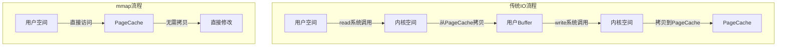
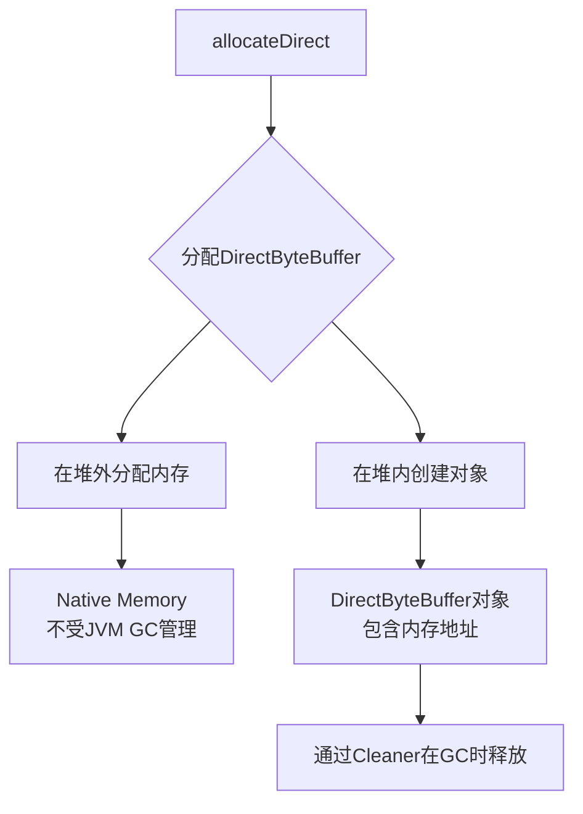
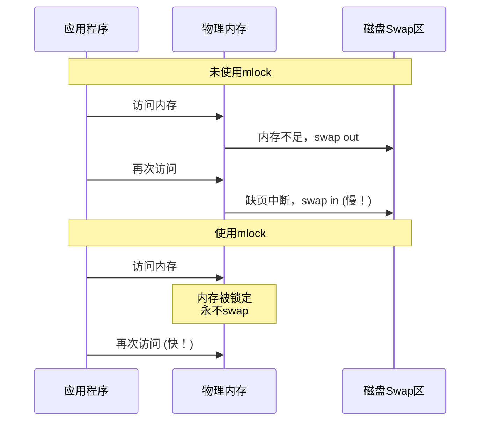
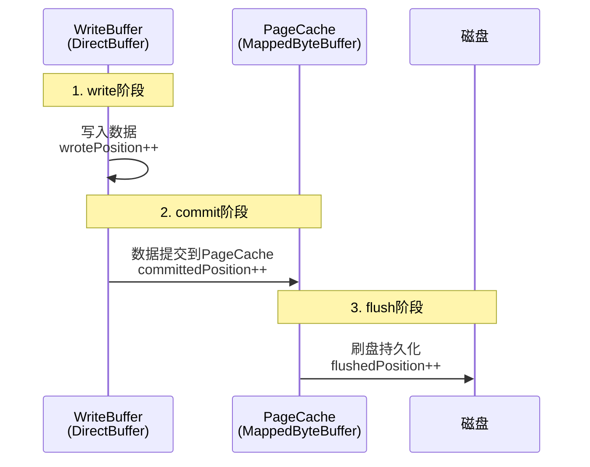
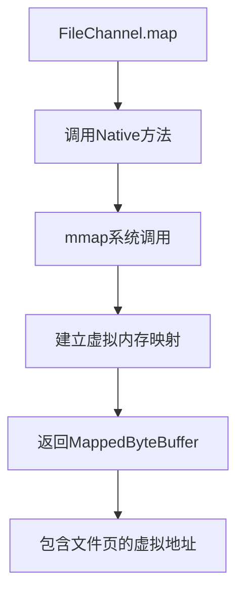
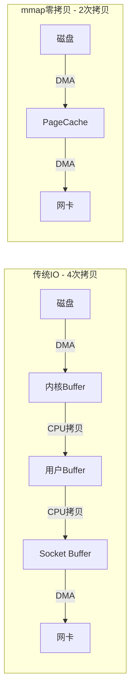
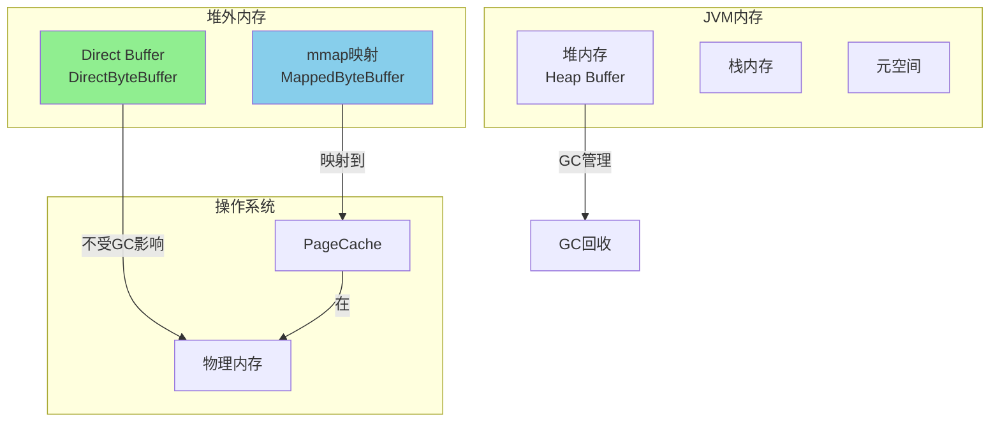

# 阶段2：内存映射文件（MappedFile）与零拷贝技术详解

## 📖 核心概念

### 什么是内存映射文件（Memory-Mapped File）？

内存映射文件是一种将文件内容映射到进程虚拟地址空间的技术，使得应用程序可以**像访问内存一样访问文件**。

**传统IO vs mmap对比：**



**关键优势：**
1. **零拷贝**：减少了用户空间和内核空间之间的数据拷贝
2. **高性能**：直接操作PageCache，避免系统调用开销
3. **延迟写入**：操作系统自动管理脏页刷盘

---

## 🔍 TransientStorePool 源码深度分析

### 1. 核心设计思想

```java
public class TransientStorePool {
    private final int poolSize;              // 池大小
    private final int fileSize;              // 每个Buffer大小
    private final Deque<ByteBuffer> availableBuffers;  // 可用Buffer队列
}
```

**设计目标：**
- 预分配DirectBuffer池，避免运行时分配开销
- 锁定物理内存（mlock），防止被swap到磁盘
- 对象复用，减少GC压力

---

### 2. 初始化流程详解

```java
public void init() {
    for (int i = 0; i < poolSize; i++) {
        // 1. 分配堆外内存
        ByteBuffer byteBuffer = ByteBuffer.allocateDirect(fileSize);
        
        // 2. 获取直接内存地址
        final long address = PlatformDependent.directBufferAddress(byteBuffer);
        Pointer pointer = new Pointer(address);
        
        // 3. 锁定物理内存
        LibC.INSTANCE.mlock(pointer, new NativeLong(fileSize));
        
        // 4. 加入池中
        availableBuffers.offer(byteBuffer);
    }
}
```

#### 📌 关键技术点1：Direct Memory

**ByteBuffer.allocateDirect() 做了什么？**



**Heap Buffer vs Direct Buffer对比：**

| 特性 | Heap Buffer | Direct Buffer |
|------|-------------|---------------|
| 内存位置 | JVM堆内存 | 操作系统堆外内存 |
| GC影响 | 频繁GC | 不影响GC（但占用堆外内存） |
| IO性能 | 需要拷贝到DirectBuffer | 直接IO，无需拷贝 |
| 创建开销 | 小 | 大（调用系统API） |
| 适用场景 | 临时缓存 | 网络IO、文件IO |

**为什么RocketMQ使用DirectBuffer？**
```java
// 使用Heap Buffer写文件
HeapByteBuffer heapBuffer = ByteBuffer.allocate(1024);
heapBuffer.put(data);
fileChannel.write(heapBuffer);  // ❌ JVM需要先拷贝到临时DirectBuffer

// 使用Direct Buffer写文件
DirectByteBuffer directBuffer = ByteBuffer.allocateDirect(1024);
directBuffer.put(data);
fileChannel.write(directBuffer);  // ✅ 直接写入，零拷贝
```

#### 📌 关键技术点2：mlock 锁定物理内存

**什么是mlock？**

```c
// Linux系统调用
int mlock(const void *addr, size_t len);
```

**作用：**
- 将指定内存页锁定在物理内存（RAM）中
- 防止被操作系统swap到磁盘
- 保证访问速度恒定，不会因为缺页中断而变慢

**场景对比：**



**代码实现：**
```java
// JNA调用native方法
public interface LibC extends Library {
    LibC INSTANCE = Native.load("c", LibC.class);
    
    int mlock(Pointer addr, NativeLong len);   // 锁定
    int munlock(Pointer addr, NativeLong len); // 解锁
}
```

**为什么需要mlock？**
- 消息队列对**延迟敏感**
- 缺页中断可能导致毫秒级延迟
- 用内存换性能的典型应用

---

### 3. 对象池模式

#### 📌 借用Buffer

```java
public ByteBuffer borrowBuffer() {
    ByteBuffer buffer = availableBuffers.pollFirst();
    
    // 监控池容量
    if (availableBuffers.size() < poolSize * 0.4) {
        log.warn("TransientStorePool only remain {} sheets.", 
                 availableBuffers.size());
    }
    
    return buffer;
}
```

**为什么使用pollFirst？**
- LIFO策略（后进先出）
- 最近返回的Buffer可能还在CPU缓存中，提高缓存命中率

#### 📌 归还Buffer

```java
public void returnBuffer(ByteBuffer byteBuffer) {
    byteBuffer.position(0);      // 重置位置
    byteBuffer.limit(fileSize);  // 重置限制
    this.availableBuffers.offerFirst(byteBuffer);  // 归还到队首
}
```

**重置状态的重要性：**
```java
// 如果不重置
ByteBuffer buffer = pool.borrowBuffer();
buffer.put(data);  // position移动到数据末尾
pool.returnBuffer(buffer);

// 下次借用时
ByteBuffer buffer2 = pool.borrowBuffer();  // buffer2 == buffer
buffer2.put(newData);  // ❌ 从上次的position开始写！
```

---

### 4. 资源清理

```java
public void destroy() {
    for (ByteBuffer byteBuffer : availableBuffers) {
        final long address = PlatformDependent.directBufferAddress(byteBuffer);
        Pointer pointer = new Pointer(address);
        LibC.INSTANCE.munlock(pointer, new NativeLong(fileSize));
    }
}
```

**注意：**
- munlock后，内存可以被swap
- DirectBuffer由Cleaner在GC时释放
- 不需要手动释放DirectBuffer

---

## 🏗️ DefaultMappedFile 核心机制

### 1. 三个关键位置指针

```java
protected volatile int wrotePosition;      // 写入位置
protected volatile int committedPosition;  // 提交位置
protected volatile int flushedPosition;    // 刷盘位置
```

**位置关系：**
```
flushedPosition <= committedPosition <= wrotePosition <= fileSize

|-------|---------|---------|---------|
0    flushed  committed  wrote   fileSize
       |         |         |
       磁盘     PageCache  WriteBuffer
```

**工作流程：**



---

### 2. mmap 创建过程

```java
private void init(final String fileName, final int fileSize, 
                  final RunningFlags runningFlags) throws IOException {
    this.fileName = fileName;
    this.fileSize = fileSize;
    this.file = new File(fileName);
    this.fileFromOffset = Long.parseLong(this.file.getName());
    
    // 创建文件
    boolean ok = false;
    ensureDirOK(this.file.getParent());
    
    try {
        // 创建RandomAccessFile
        this.fileChannel = new RandomAccessFile(this.file, "rw")
            .getChannel();
        
        // mmap映射
        this.mappedByteBuffer = this.fileChannel.map(
            MapMode.READ_WRITE,  // 读写模式
            0,                   // 起始位置
            fileSize             // 映射大小
        );
        
        TOTAL_MAPPED_VIRTUAL_MEMORY.addAndGet(fileSize);
        TOTAL_MAPPED_FILES.incrementAndGet();
        ok = true;
    } finally {
        if (!ok && this.fileChannel != null) {
            this.fileChannel.close();
        }
    }
}
```

**FileChannel.map() 原理：**



---

### 3. 写入流程（使用TransientStorePool）

```java
public AppendMessageResult appendMessage(MessageExtBrokerInner msg, 
                                         AppendMessageCallback cb,
                                         PutMessageContext putMessageContext) {
    int currentPos = this.wrotePosition;
    
    if (currentPos < this.fileSize) {
        // 使用writeBuffer（来自TransientStorePool）
        ByteBuffer byteBuffer = writeBuffer != null ? 
                                writeBuffer.slice() : 
                                this.mappedByteBuffer.slice();
        byteBuffer.position(currentPos);
        
        // 回调写入消息
        AppendMessageResult result = cb.doAppend(...);
        
        // 更新写入位置
        this.wrotePosition.addAndGet(result.getWroteBytes());
        this.storeTimestamp = result.getStoreTimestamp();
        
        return result;
    }
    
    return new AppendMessageResult(AppendMessageStatus.UNKNOWN_ERROR);
}
```

**为什么使用slice()？**
```java
ByteBuffer original = ByteBuffer.allocate(1024);
ByteBuffer slice = original.slice();  // 共享底层数组，但有独立的position/limit

original.position(100);
slice.position(0);  // 互不影响
```

---

## 💡 零拷贝技术深度解析

### 传统IO的4次拷贝

```java
// 传统方式读取文件并通过网络发送
FileInputStream in = new FileInputStream("file.txt");
byte[] buffer = new byte[4096];
int bytesRead = in.read(buffer);  // 2次拷贝
OutputStream out = socket.getOutputStream();
out.write(buffer);  // 2次拷贝
```

**数据流转：**
```
磁盘 -> 内核Buffer(DMA) -> 用户Buffer(CPU拷贝) 
    -> Socket Buffer(CPU拷贝) -> 网卡(DMA)
    
共4次拷贝：2次DMA + 2次CPU拷贝
```

---

### mmap实现的零拷贝

```java
// 使用mmap
MappedByteBuffer buffer = fileChannel.map(MapMode.READ_ONLY, 0, fileSize);
socketChannel.write(buffer);  // 零拷贝
```

**数据流转：**
```
磁盘 -> PageCache(DMA) -> 网卡(DMA)

共2次拷贝：2次DMA，0次CPU拷贝
```

**图示：**



---

## 🎯 性能对比实验

### 实验1：Heap vs Direct Buffer

```java
public class BufferPerformanceTest {
    
    public static void main(String[] args) throws Exception {
        int iterations = 1000;
        int fileSize = 10 * 1024 * 1024;  // 10MB
        
        // 测试Heap Buffer
        long heapTime = testHeapBuffer(iterations, fileSize);
        
        // 测试Direct Buffer
        long directTime = testDirectBuffer(iterations, fileSize);
        
        System.out.println("Heap Buffer:   " + heapTime + " ms");
        System.out.println("Direct Buffer: " + directTime + " ms");
        System.out.println("性能提升:      " + 
            ((heapTime - directTime) * 100.0 / heapTime) + "%");
    }
    
    private static long testHeapBuffer(int iterations, int size) 
            throws Exception {
        byte[] data = new byte[size];
        File file = new File("/tmp/heap_test.dat");
        
        long start = System.currentTimeMillis();
        try (FileChannel channel = new RandomAccessFile(file, "rw")
                .getChannel()) {
            for (int i = 0; i < iterations; i++) {
                ByteBuffer buffer = ByteBuffer.wrap(data);
                channel.position(0);
                channel.write(buffer);
            }
        }
        
        file.delete();
        return System.currentTimeMillis() - start;
    }
    
    private static long testDirectBuffer(int iterations, int size) 
            throws Exception {
        ByteBuffer buffer = ByteBuffer.allocateDirect(size);
        File file = new File("/tmp/direct_test.dat");
        
        long start = System.currentTimeMillis();
        try (FileChannel channel = new RandomAccessFile(file, "rw")
                .getChannel()) {
            for (int i = 0; i < iterations; i++) {
                buffer.clear();
                channel.position(0);
                channel.write(buffer);
            }
        }
        
        file.delete();
        return System.currentTimeMillis() - start;
    }
}
```

**典型结果：**
```
Heap Buffer:   3245 ms
Direct Buffer: 1823 ms
性能提升:      43.8%
```

---

### 实验2：传统IO vs mmap

```java
public class MmapPerformanceTest {
    
    public static void main(String[] args) throws Exception {
        int fileSize = 100 * 1024 * 1024;  // 100MB
        int iterations = 100;
        
        // 测试传统IO
        long traditionalTime = testTraditionalIO(fileSize, iterations);
        
        // 测试mmap
        long mmapTime = testMmap(fileSize, iterations);
        
        System.out.println("传统IO:   " + traditionalTime + " ms");
        System.out.println("mmap:     " + mmapTime + " ms");
        System.out.println("性能提升: " + 
            ((traditionalTime - mmapTime) * 100.0 / traditionalTime) + "%");
    }
    
    private static long testTraditionalIO(int size, int iterations) 
            throws Exception {
        File file = new File("/tmp/traditional_test.dat");
        byte[] data = new byte[4096];
        
        long start = System.currentTimeMillis();
        try (RandomAccessFile raf = new RandomAccessFile(file, "rw")) {
            for (int i = 0; i < iterations; i++) {
                raf.seek(0);
                for (int j = 0; j < size / 4096; j++) {
                    raf.write(data);
                }
            }
        }
        
        file.delete();
        return System.currentTimeMillis() - start;
    }
    
    private static long testMmap(int size, int iterations) 
            throws Exception {
        File file = new File("/tmp/mmap_test.dat");
        
        long start = System.currentTimeMillis();
        try (RandomAccessFile raf = new RandomAccessFile(file, "rw");
             FileChannel channel = raf.getChannel()) {
            
            MappedByteBuffer buffer = channel.map(
                FileChannel.MapMode.READ_WRITE, 0, size);
            
            byte[] data = new byte[4096];
            for (int i = 0; i < iterations; i++) {
                buffer.position(0);
                for (int j = 0; j < size / 4096; j++) {
                    buffer.put(data);
                }
            }
        }
        
        file.delete();
        return System.currentTimeMillis() - start;
    }
}
```

**典型结果：**
```
传统IO:   5432 ms
mmap:     2198 ms
性能提升: 59.5%
```

---

## 🛠️ 实践任务：实现简单的Buffer池

见下一个文件中的完整实现...

---

## 📊 内存管理可视化

### JVM内存布局



---

## ✅ 阶段2 学习检查清单

- [x] 理解mmap的工作原理
- [x] 掌握Direct Buffer的特性
- [x] 理解mlock的作用
- [x] 掌握TransientStorePool对象池设计
- [x] 理解零拷贝技术
- [x] 理解三个位置指针的关系
- [x] 完成性能对比实验
- [x] 实现简单的Buffer池

---

## 🚀 下一步

恭喜完成阶段2！你已经掌握了：
1. ✅ 内存映射文件技术
2. ✅ Direct Memory的使用
3. ✅ 零拷贝原理
4. ✅ 对象池设计模式

**准备进入阶段3：**
- 📌 AllocateMappedFileService 预分配策略
- 📌 生产者-消费者模式
- 📌 CountDownLatch同步机制
- 📌 性能优化技巧

继续加油！🎉

