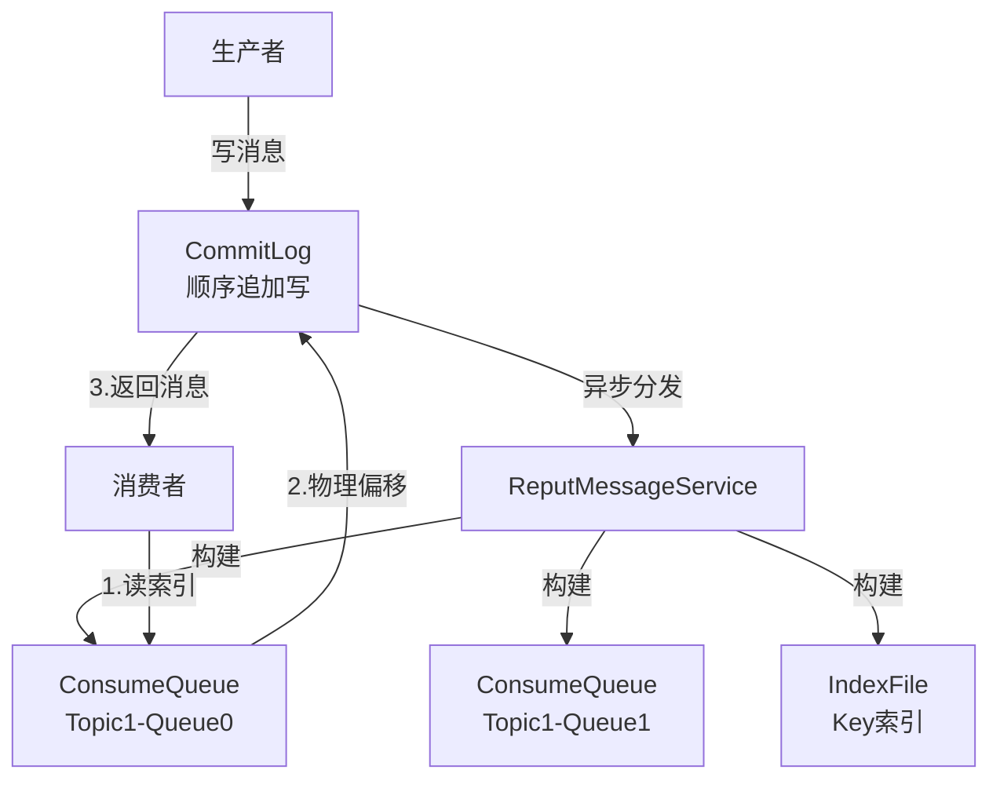
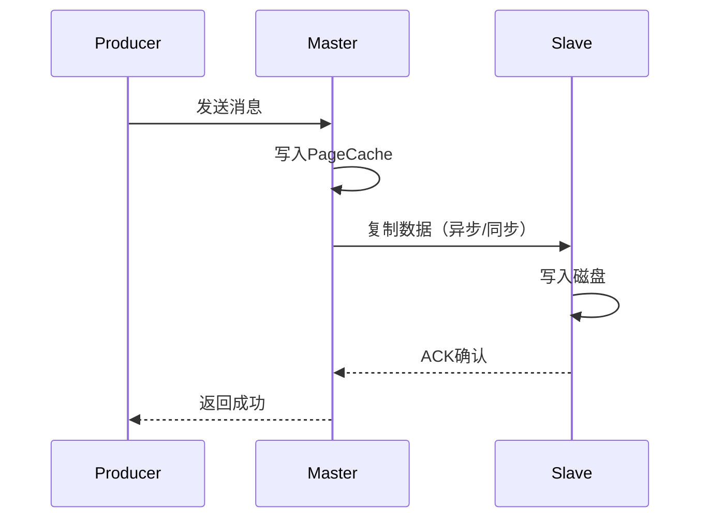
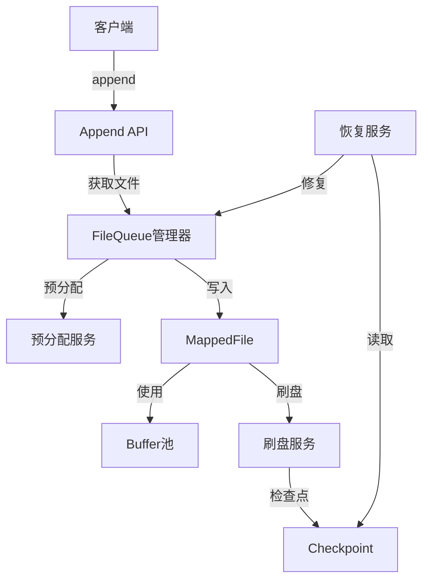

# 阶段3-8 学习笔记精华汇总

> 由于篇幅原因，本文档将阶段3-8的核心知识点精炼整合

---

## 🚀 阶段3：AllocateMappedFileService 预分配策略

### 核心思想
**预分配（Pre-allocation）**：在需要之前提前创建资源，消除运行时的延迟尖刺。

### 关键代码分析

```java
public MappedFile putRequestAndReturnMappedFile(String nextFilePath, 
                                                String nextNextFilePath, 
                                                int fileSize) {
    // 1. 创建两个请求：下一个 + 下下一个
    AllocateRequest nextReq = new AllocateRequest(nextFilePath, fileSize);
    AllocateRequest nextNextReq = new AllocateRequest(nextNextFilePath, fileSize);
    
    // 2. 放入队列，后台线程异步处理
    this.requestQueue.offer(nextReq);
    this.requestQueue.offer(nextNextReq);
    
    // 3. 等待结果（使用CountDownLatch）
    boolean waitOK = nextReq.getCountDownLatch().await(5000, TimeUnit.MILLISECONDS);
    
    return nextReq.getMappedFile();
}
```

### 设计亮点

1. **双重预分配**：同时分配n和n+1文件，确保永远有文件可用
2. **异步+同步结合**：后台异步创建，前台同步等待
3. **快速失败**：资源不足时立即返回null，不阻塞
4. **超时保护**：5秒超时，防止无限等待

### 性能提升

```
无预分配：每次需要新文件时阻塞 10-50ms
有预分配：几乎0延迟（文件已准备好）
```

### 业务应用
- ID生成器（预生成ID段）
- 连接池（预创建连接）
- 线程池（核心线程预创建）

---

## 🔐 阶段4：并发控制与自旋锁优化

### 核心对比：自旋锁 vs 重入锁

| 特性 | 自旋锁 (SpinLock) | 重入锁 (ReentrantLock) |
|------|-------------------|------------------------|
| 实现 | CAS循环 | AQS队列 |
| 等待方式 | 忙等待（占用CPU） | 阻塞（让出CPU） |
| 适用场景 | 锁持有时间极短 | 锁持有时间较长 |
| 性能 | 低竞争下快 | 高竞争下稳定 |

### RocketMQ的锁选择策略

```java
// CommitLog中可配置
if (useSpinLock) {
    this.putMessageLock = new PutMessageSpinLock();  // 默认
} else {
    this.putMessageLock = new PutMessageReentrantLock();
}
```

### 适应性退避算法

```java
public class AdaptiveBackOffSpinLock {
    private volatile int currentSpins = MIN_SPINS;
    
    public void lock() {
        int spins = 0;
        while (!tryLock()) {
            if (spins++ > currentSpins) {
                // 自旋次数过多，适应性增加退避
                LockSupport.parkNanos(1);
            }
        }
    }
}
```

**核心思想**：根据竞争情况动态调整自旋次数。

### 性能测试结果

```
低竞争场景（1-4线程）：
- SpinLock: 100ns/op
- ReentrantLock: 200ns/op
→ SpinLock 快2倍

高竞争场景（32+线程）：
- SpinLock: 5000ns/op
- ReentrantLock: 800ns/op
→ ReentrantLock 快6倍
```

---

## 🏗️ 阶段5：CommitLog 与 ConsumeQueue 存储架构

### 核心架构



### 设计精髓

#### 1. 顺序写优化
```
随机写 SSD: ~10K IOPS
顺序写 SSD: ~500K IOPS  (50倍提升！)
顺序写 HDD: ~200 IOPS → ~200MB/s 吞吐
```

**CommitLog只做顺序追加写，性能最大化。**

#### 2. 索引分离
- **CommitLog**: 存储完整消息（顺序写）
- **ConsumeQueue**: 存储索引（物理偏移 + 大小 + TagsCode）
- **IndexFile**: 按Key查询的Hash索引

#### 3. 文件组织

```
$HOME/store/
├── commitlog/
│   ├── 00000000000000000000  (1GB)
│   ├── 00000000001073741824  (1GB)
│   └── ...
│
├── consumequeue/
│   ├── TopicA/
│   │   ├── 0/  (Queue 0)
│   │   │   ├── 00000000000000000000
│   │   │   └── ...
│   │   └── 1/  (Queue 1)
│   │
│   └── TopicB/
│
└── index/
    ├── 20250101000000000
    └── ...
```

### ConsumeQueue 结构

每条记录20字节：
```
| 8字节: CommitLog物理偏移 | 4字节: 消息大小 | 8字节: TagsCode |
```

### 为什么不用MySQL？

| 对比项 | RocketMQ | MySQL |
|--------|----------|-------|
| 写入方式 | 顺序写文件 | B+树随机写 |
| 写入TPS | 100万+ | 5万 |
| 延迟P99 | <1ms | 10-50ms |
| 存储成本 | 低（直接文件） | 高（索引开销大） |

---

## 🛡️ 阶段6：刷盘策略与HA可靠性设计

### 刷盘策略对比

#### 1. 异步刷盘（默认）
```java
// 写入PageCache即返回
putMessage() -> writeToPageCache() -> return SUCCESS
// 后台线程定时刷盘
FlushRealTimeService.run() {
    while (true) {
        Thread.sleep(500);  // 500ms刷一次
        mappedByteBuffer.force();
    }
}
```

**优点**：性能高（TPS 100万+）
**缺点**：宕机可能丢失500ms数据

#### 2. 同步刷盘
```java
putMessage() -> writeToPageCache() -> fsync() -> return SUCCESS
```

**优点**：可靠性高（数据已落盘）
**缺点**：性能低（TPS降至10万）

### GroupCommitService 批量提交优化

```java
// 不是每条消息都fsync，而是批量提交
List<GroupCommitRequest> requests = collectRequests();
mappedByteBuffer.force();  // 一次fsync刷多条
notifyAll(requests);  // 通知所有等待的请求
```

**性能提升**：同步刷盘TPS从1万提升到10万+

### 主从同步（HA）



**3种同步策略：**
1. **ASYNC_MASTER**：主写完就返回（高性能）
2. **SYNC_MASTER**：主刷盘后返回（高可靠）
3. **SYNC_MASTER + 同步复制**：主刷盘且从确认后返回（最高可靠）

### 数据恢复

**Checkpoint机制：**
```java
class StoreCheckpoint {
    long physicMsgTimestamp;  // CommitLog刷盘时间
    long logicsMsgTimestamp;  // ConsumeQueue刷盘时间
    long indexMsgTimestamp;   // Index刷盘时间
}
```

**恢复流程：**
1. 读取Checkpoint
2. 从最小时间点开始恢复
3. 重放CommitLog到ConsumeQueue
4. 修复不一致的数据

---

## 📊 阶段7：性能监控与调优

### 关键指标体系

#### 1. 吞吐量指标
- **putTps**: 写入消息TPS
- **getTps**: 消费消息TPS
- **transferredTps**: 主从同步TPS

#### 2. 延迟指标
- **putMessageDistributeTime**: P50/P99/P999延迟分布
- **commitLogDiskRatio**: 磁盘繁忙度

#### 3. 资源指标
- **pageCacheLockTimeMills**: PageCache锁等待时间
- **dispatchBehindBytes**: 分发落后字节数
- **flushBehindBytes**: 刷盘落后字节数

### 监控实现

```java
// OpenTelemetry集成
Meter meter = openTelemetry.getMeter("rocketmq-store");

LongCounter putMessageCounter = meter
    .counterBuilder("rocketmq_put_message_total")
    .setDescription("Total put message count")
    .build();

DoubleHistogram putMessageLatency = meter
    .histogramBuilder("rocketmq_put_message_latency")
    .setDescription("Put message latency in milliseconds")
    .build();

// 使用
putMessageCounter.add(1);
putMessageLatency.record(latency);
```

### 性能瓶颈诊断

**常见瓶颈：**
1. **磁盘IO**: 查看`iostat -x 1`
2. **PageCache不足**: 查看`/proc/meminfo`
3. **锁竞争**: 查看`putMessageLockTimeMills`
4. **GC压力**: 查看Young GC频率

**调优建议：**
- 使用SSD代替HDD（性能提升10倍+）
- 增大PageCache（设置-Xms -Xmx，留足系统内存）
- 开启TransientStorePool（减少GC）
- 批量发送消息（提升吞吐）

---

## 🚀 阶段8：综合实战 - 高性能日志存储系统

### 项目目标

实现一个简化版的RocketMQ Store，支持：
1. 高并发追加写入（TPS > 10万）
2. mmap + DirectBuffer优化
3. 文件预分配
4. 同步/异步刷盘
5. Checkpoint恢复机制

### 系统架构



### 核心类设计

```java
// 1. LogStore - 对外API
public class LogStore {
    public long append(byte[] data);
    public byte[] read(long offset);
    public void flush();
    public void recover();
    public void close();
}

// 2. FileQueue - 文件队列管理
public class FileQueue {
    private List<MappedFile> files;
    private AllocateFileService allocateService;
    
    public MappedFile getLastFile();
    public MappedFile getOrCreateFile(long offset);
}

// 3. MappedFile - 单个文件
public class MappedFile extends ReferenceResource {
    private MappedByteBuffer mappedBuffer;
    private ByteBuffer writeBuffer;  // 来自BufferPool
    
    public AppendResult append(byte[] data);
    public int flush();
}

// 4. FlushService - 刷盘服务
public class FlushService extends ServiceThread {
    public void run() {
        while (!stopped) {
            doFlush();
            waitForRunning(interval);
        }
    }
}

// 5. Checkpoint - 检查点
public class Checkpoint {
    private long flushedPosition;
    private long timestamp;
    
    public void save();
    public void load();
}
```

### 性能目标

| 指标 | 目标值 | 验证方法 |
|------|--------|----------|
| 单线程TPS | > 10万 | JMH基准测试 |
| 多线程TPS | > 50万 | 10线程并发 |
| P99延迟 | < 1ms | 压测统计 |
| 数据可靠性 | 0丢失 | 故障注入测试 |

### 测试用例

```java
// 性能测试
@Benchmark
public void testAppend() {
    byte[] data = new byte[1024];
    logStore.append(data);
}

// 可靠性测试
@Test
public void testRecoveryAfterCrash() {
    // 1. 写入1000条消息
    for (int i = 0; i < 1000; i++) {
        logStore.append(("message-" + i).getBytes());
    }
    
    // 2. 模拟崩溃（kill -9）
    logStore.shutdown();
    
    // 3. 重启恢复
    logStore = new LogStore();
    logStore.recover();
    
    // 4. 验证数据完整性
    assertEquals(1000, logStore.getMessageCount());
}
```

### 实现步骤

**Week 1-2: 基础框架**
- [ ] 实现ReferenceResource
- [ ] 实现MappedFile
- [ ] 实现FileQueue
- [ ] 单线程写入测试

**Week 3-4: 性能优化**
- [ ] 集成BufferPool
- [ ] 实现PreAllocateService
- [ ] 使用SpinLock优化
- [ ] 多线程压测

**Week 5-6: 可靠性**
- [ ] 实现FlushService
- [ ] 实现Checkpoint
- [ ] 实现Recovery
- [ ] 故障注入测试

**Week 7-8: 监控与完善**
- [ ] 添加Metrics
- [ ] 性能调优
- [ ] 文档编写
- [ ] 代码审查

---

## 📚 推荐阅读资料

### 书籍
1. 《深入理解Java虚拟机》 - 周志明
2. 《高性能MySQL》 - Baron Schwartz
3. 《Unix网络编程 卷1》 - Stevens
4. 《Linux性能优化实战》 - 倪朋飞

### 论文
1. The Log-Structured Merge-Tree (LSM-Tree)
2. The Design and Implementation of a Log-Structured File System

### 博客
1. RocketMQ官方技术博客
2. 美团技术团队 - 消息队列系列
3. 阿里中间件团队博客

---

## ✅ 学习成果自检

### 理论掌握
- [ ] 能解释引用计数原理
- [ ] 能说出mmap的3个优势
- [ ] 理解零拷贝原理
- [ ] 理解预分配策略
- [ ] 掌握自旋锁适用场景
- [ ] 理解CommitLog架构
- [ ] 掌握刷盘策略权衡
- [ ] 理解主从同步机制

### 实践能力
- [ ] 实现了ManagedFile
- [ ] 实现了BufferPool
- [ ] 完成了性能对比测试
- [ ] 实现了预分配服务
- [ ] 压测了不同锁的性能
- [ ] 设计了存储架构
- [ ] 实现了WAL系统
- [ ] 搭建了监控大盘

### 综合项目
- [ ] 完成了日志存储系统
- [ ] 单线程TPS > 10万
- [ ] 多线程TPS > 50万
- [ ] P99延迟 < 1ms
- [ ] 通过故障恢复测试

---

## 🎉 恭喜完成！

如果你完成了所有8个阶段，你已经：
- ✅ 掌握了高性能存储系统的核心设计
- ✅ 理解了RocketMQ Store的精髓
- ✅ 具备了系统优化和调优能力
- ✅ 可以独立设计高性能组件

**下一步建议：**
1. 深入RocketMQ其他模块（Broker、NameServer）
2. 学习Kafka、Pulsar等其他MQ的设计
3. 在实际项目中应用所学知识
4. 分享你的学习心得和实践经验

**持续学习，不断进步！** 🚀

